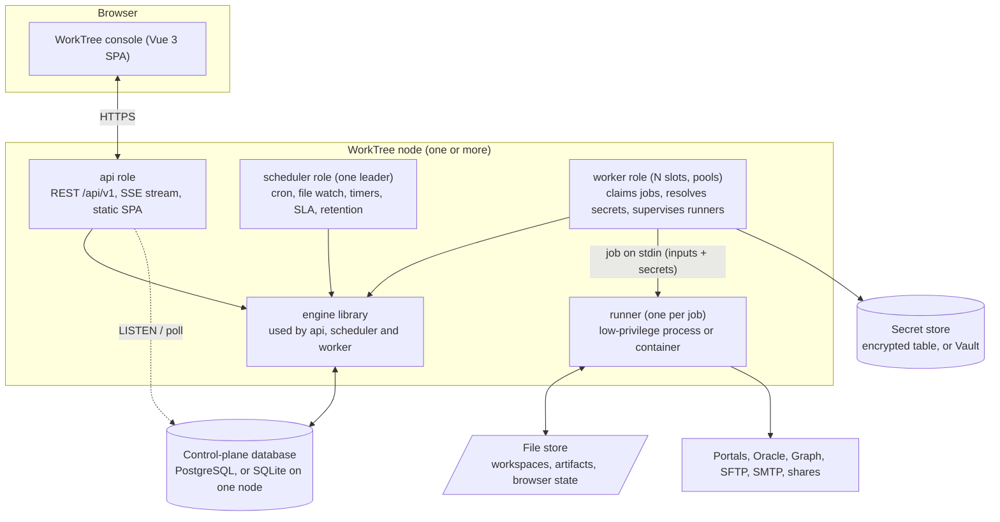
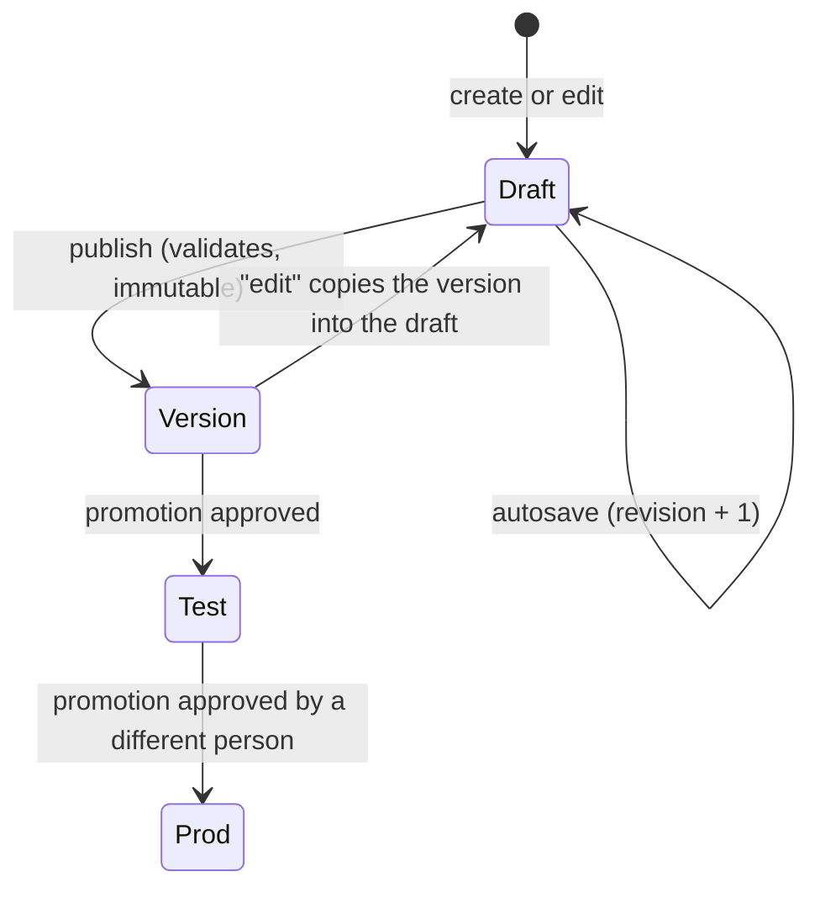
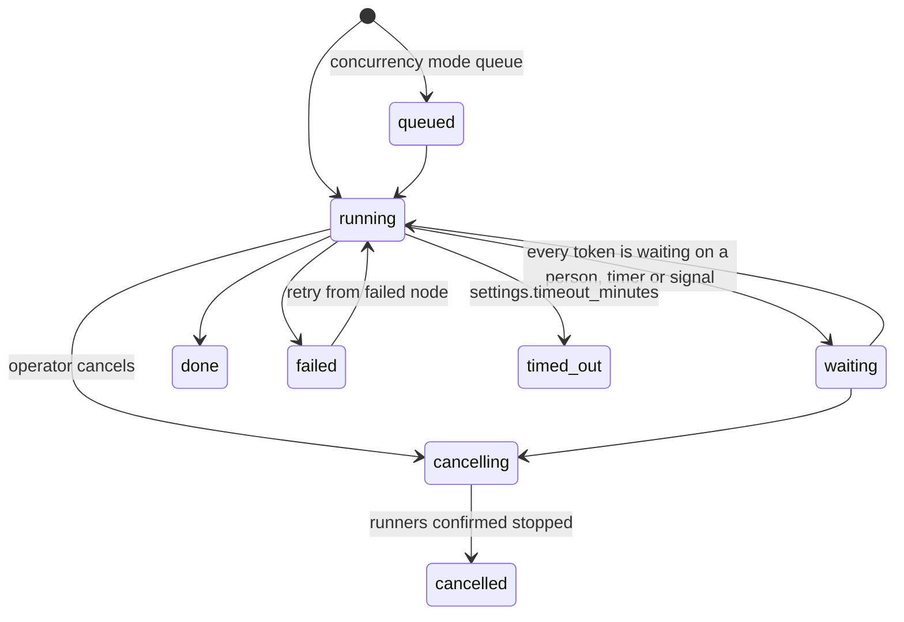

# WorkTree system design (target)

Written 2026-11-11. This is the design WorkTree should have, developed from a full review of the
code as it stands. It is a target, not a description of the present: `03-upgrade-guide.md` lists
what exists today and the steps between the two. Where this document keeps a current mechanism it
says **keep**; where it replaces one it says **change** and gives the reason.

Decisions that need the owner's sign-off are collected in section 16.

## 1. Goals and limits

**Goals**

1. Run hundreds of workflows a day on one modest server, and scale to several servers without a
   redesign.
2. Never lose or duplicate a step because a process died.
3. Make every action attributable, and every credential unreachable except by the step that needs it.
4. Let an Author build a real workflow (branches, loops, parallel work, waits, people) without code.
5. Keep the install simple: one package, one database, no message broker.

**Limits kept on purpose**

- On-premise only. No telemetry leaves the server.
- No broker, no Redis, no Kubernetes requirement. The database is the queue.
- Python 3.12, FastAPI, SQLAlchemy 2, Vue 3. No change of stack.
- Activities stay one Python class each, with a pydantic input model.

**Numbers to design for**

| Measure | Target |
|---|---|
| Active runs at once | 500 |
| Steps dispatched per minute | 600 |
| Run history kept online | 2 million runs |
| Time from an event to the screen | under 1 second |
| Time from a step finishing to the next starting | under 200 ms (today: up to 15 s on some paths) |
| Dashboard and list pages, p95 | under 500 ms |
| Recovery after a crash | automatic, under 30 s, no duplicate side effects for idempotent steps |

## 2. What changes from today, in one table

| Area | Today | Target | Why |
|---|---|---|---|
| Process model | API, scheduler and workers are threads in one process | Three roles (`api`, `scheduler`, `worker`) that can share one process or run separately | Workers can scale and restart without the API; a hung thread cannot stall the server |
| Engine progress | One `current_step` per run, a process-wide lock, a 15 s scan of 200 runs | Token-based execution, a per-run database lock, event-driven wake-ups | Parallel branches; no starvation above 200 runs; multi-process safe |
| Workflow model | `on_done` / `on_failed` only | Typed nodes joined by edges with named ports and conditions | If, switch, parallel, merge, wait and error handlers need it; the approved canvas already draws them |
| Saving | Every save is a new immutable version | Editable draft, explicit publish | The Studio must autosave without creating hundreds of versions |
| Database | SQLite by default, Oracle path untested, schema made by `create_all` at start | SQLite for one node, PostgreSQL for production, Alembic only | Real concurrency, real constraints, one schema path |
| Secrets | Plaintext JSON file, any Author can use any secret anywhere | Encrypted at rest, policy per secret (placement, hosts, environments) | Closes SEC-10 and the plaintext file |
| Isolation | Child process as the server's own OS user | Low-privilege worker account, resource limits, optional container runner | A step must not read the database or other runs' files |
| Access | Roles only; every Viewer reads every run | Roles plus folder-level access | Payroll runs should not be visible to everyone |
| Live updates | Every event to every user, ids only | Topic subscriptions with permission checks, payload included | Fewer refetches, no information leak |
| Audit | Unkeyed hash chain in the same database | Keyed chain plus a signed daily anchor kept outside the database | A database writer can currently forge a valid chain |
| Naming | `uaf` in the package, CLI, cookies, env prefix | `worktree` everywhere, old names accepted for one release | The product has one name |

## 3. Architecture



### 3.1 Roles

One executable, three roles, chosen on the command line:

```
worktree serve                 # all three roles in one process (default, small installs)
worktree serve --role api
worktree serve --role scheduler
worktree serve --role worker --pool default --slots 4
worktree serve --role worker --pool browser --slots 2
```

- **api** serves HTTP, validates, authorises, and calls services. It never runs an activity.
- **scheduler** owns everything time-based. Exactly one instance is active: it holds a database
  lease (`leases` table, 30 s, renewed every 10 s). A second instance stands by and takes over when
  the lease lapses.
- **worker** claims jobs for its pool and supervises one runner per job.

**Keep** the import-linter layer contract (`api -> services -> engine -> workers -> audit ->
security -> bus -> adapters -> domain`). Add `app.roles` above `api` to hold the three entry points.

### 3.2 Why not a broker, Temporal or Celery

The engine writes run state and the next job in the same transaction. That outbox guarantee is the
reason a crash never loses a step, and a broker cannot join the transaction. PostgreSQL
`SELECT ... FOR UPDATE SKIP LOCKED` with `LISTEN/NOTIFY` gives the throughput in section 1 with no
extra service. The `rabbitmq` option in the settings is removed.

## 4. Workflow model (schema version 2)

### 4.1 Shape

```yaml
schema_version: 2
name: Invoice reconciliation
folder: Finance/Reconciliations
inputs:                         # new: typed run inputs, drives the Run now form
  period_end: {type: date, required: true, label: Period end}
  report_to:  {type: email, required: true}
settings:
  concurrency: {mode: reject, key: "{{ inputs.period_end }}"}   # allow | reject | queue
  timeout_minutes: 120          # whole-run limit, enforced
  sla_minutes: 60
  persistence: summary          # none | summary | full
  on_error: notify_failure      # optional node that runs when the run fails
nodes:
  - id: login
    type: activity
    activity: playwright_robot
    inputs: {...}
    retry: {count: 1, delay_seconds: 30, backoff: 2}
    timeout_seconds: 300
  - id: has_unmatched
    type: if
    condition: "{{ nodes.match.unmatched_left > 0 }}"
  - id: review
    type: human_task
    inputs: {type: manual_match, assignee_role: operator, due_minutes: 240}
edges:
  - {from: login,         port: done,  to: download}
  - {from: has_unmatched, port: true,  to: review}
  - {from: has_unmatched, port: false, to: report}
  - {from: review,        port: done,  to: report}
```

### 4.2 Node types

| Type | Ports out | Behaviour | Engine status today |
|---|---|---|---|
| `trigger` | `out` | Entry point. Documents how the run starts; several allowed | implied, not a node |
| `activity` | `done`, `failed` | Dispatches a job to a worker | exists |
| `human_task` | one per decision, plus `failed` | Creates a task and waits | exists (done or failed only) |
| `subworkflow` | `done`, `failed` | Starts a pinned version as a child run | exists |
| `if` | `true`, `false` | Evaluates a condition in the engine | new |
| `switch` | one per rule, plus `default` | First matching rule, or all matching | new |
| `parallel` | one per branch | Starts every branch at once | new |
| `merge` | `done` | Waits for `all`, `any` or `n` incoming tokens | new |
| `foreach` | `each`, `done` | Runs a body per item with `concurrency: n` | exists as a step field, sequential only |
| `wait` | `done` | Until a duration, a time, or an external signal | new (`sleep` activity holds a worker today) |
| `set` | `done` | Computes values in the engine, no worker | new |
| `stop` | none | Ends the run as done or failed with a message | new (`fail` activity today) |

Every node also accepts `disabled: true` (the engine passes straight through its `done` port; the
field exists today but is ignored), `notes`, and `position`.

### 4.3 Expressions

**Keep** the `{{ ... }}` template syntax and the rule that a string that is exactly one reference
keeps its type. **Keep** the secret nonce binding: it is the right design.

**Change**: references become a small, safe expression language so conditions are possible.

- Roots: `inputs`, `nodes.<id>` (alias `steps.<id>` for v1), `run`, `item`, `env`, `secret:<name>`.
- Operators: comparison, `and`, `or`, `not`, `in`, arithmetic, `??` for a default.
- Functions: a fixed list (`length`, `lower`, `upper`, `trim`, `contains`, `starts_with`, `date`,
  `format_date`, `to_number`, `round`, `first`, `last`, `keys`).
- No attribute access on Python objects, no calls outside the list, no loops. Parsed to an AST by
  our own parser and evaluated by a tree walker with a step budget. Never `eval`.
- `secret:` is legal only as a whole value in a credential input (section 9.2). The parser rejects
  it inside any expression.

### 4.4 Validation

Run at save, at publish and at promotion. All issues are returned together with `node_id` and
`field` so the canvas can mark the exact place.

Structural: unique ids, known node types, known activities, every edge joins real ports, every node
reachable, no cycle outside a `foreach` body, every `parallel` reaches a `merge` or ends, exactly the
ports the type declares.
Data: every reference names an upstream node (one that is guaranteed to have run on every path to
this node, or the reference must carry a `??` default), input values match the activity's JSON
Schema where they are literals, secret placement and policy (section 9.2).

### 4.5 Drafts, versions and publishing



- One draft per workflow, saved with optimistic concurrency (`If-Match: <revision>`). A second
  editor gets a 409 with the other person's name; nothing is silently overwritten.
- Drafts may be invalid. Versions may not.
- Dev runs the draft (for "Test run") or any version. Test and prod run only promoted versions.
  **Keep** the two segregation rules: not your own request, not your own version.
- A v1 definition is converted to v2 on read by a pure function: each step becomes an `activity`,
  `human_task` or `subworkflow` node; `on_done` and `on_failed` become edges; `foreach` becomes a
  `foreach` node around the step. Stored v1 rows are never rewritten.

## 5. Engine

### 5.1 Tokens instead of one current step

A run holds one or more **tokens**. A token is a position on the graph. `parallel` splits a token;
`merge` joins them. The run finishes when no token is left.

```
run_tokens(id, run_id, node_id, state, parent_token_id, branch_path, item_index, created_at)
state: ready | active | waiting | done | dead
```

`run_steps` (kept, one row per node execution, per iteration, per token) remains the record the
console shows.

### 5.2 Advancing a run

One function, `advance(run_id)`, is the only code that moves a run:

1. Open a transaction and lock the run row (`SELECT ... FOR UPDATE`; on SQLite the write lock).
2. For each `ready` token: engine-side nodes (`if`, `switch`, `set`, `parallel`, `merge`, `stop`,
   disabled nodes) are executed inline and the loop continues; worker nodes get a `run_steps` row
   and a job in the same transaction; waiting nodes record what they wait for.
3. Write audit and event rows. Commit.

**Change**: the process-wide `threading.RLock` goes. The run row lock gives the same safety across
processes and lets unrelated runs advance at once.

**Change**: nothing waits for a tick. Each cause calls `advance` directly or enqueues a wake-up:

| Cause | How the run wakes |
|---|---|
| Worker result | The worker calls `engine.apply_result`, which advances in the same transaction |
| Child run finished | The child's finish enqueues `wake(parent_run_id)` in the same transaction |
| Retry delay, `wait` until a time, run timeout, task SLA | A row in `timers(due_at, run_id, kind)`; the scheduler fires due timers every second |
| Task completed, signal received | The API call advances the run |
| Queued run's predecessor finished | The predecessor's finish enqueues `wake` for the next in line |

A reconciliation sweep still runs every 60 s as a safety net (it finds runs whose job finished but
whose result was not applied, and steps past their deadline). It pages through all active runs; it
has no fixed limit.

### 5.3 States



Step states: `pending`, `dispatched`, `running` (new: the worker has started it), `waiting`,
`done`, `failed`, `skipped`, `cancelled`.

### 5.4 Semantics that stay

**Keep** all of these; they are correct and tested: attempt numbers on envelopes so a stale result
is ignored; retries with delay and backoff; `resume: restart | skip` on recovery; pinned
sub-workflow versions and the prod promotion check on children; output size caps and
`persist: exclude`; masking before anything is stored; incidents for engine faults.

### 5.5 Semantics that change

- **Cancel really stops work.** Cancelling sets `cancelling`, marks jobs cancelled, and the
  worker supervising a runner sees it on its next heartbeat (2 s) and kills the process tree. Today
  the child process runs to completion after a cancel.
- **Failure handling is explicit.** A `failed` port with no edge fails the run (as today). A
  workflow-level `on_error` node runs once, with `run.error` available, before the run ends.
- **Errors carry a code.** A failed result has `error: {code, message, retryable}`. Retries apply
  only when `retryable` is true (timeouts, connection errors, HTTP 5xx and 429 by default), so a
  wrong password is not tried three times.
- **Idempotency.** Each dispatch carries `idempotency_key = run_id/node_id/iteration/attempt-group`
  in the context. Activities with side effects (`email`, `oracle_execute`, `unc_archive`, `sftp put`)
  record the key in `side_effects` and refuse to repeat on a redelivery.
- **Run timeout and SLA are enforced.** `timeout_minutes` ends the run as `timed_out`.
  `sla_minutes` raises an alert once. Both are timers. (`max_duration_minutes` exists today and
  does nothing.)

## 6. Queue

**Keep** the database queue, its visibility timeout, lease extension, dead-letter state and the
orphan release on start.

**Change**

- `queue` becomes the **pool** name. Activities declare `pool` (`default`, `browser`, `heavy`);
  a node may override it. Workers serve one or more pools.
- Priority column (`0` to `9`, default `5`); manual runs default one step above scheduled ones.
- Claim query: `ORDER BY priority DESC, id LIMIT 1 FOR UPDATE SKIP LOCKED` on PostgreSQL; the
  existing `UPDATE ... RETURNING` on SQLite.
- Workers are woken by `NOTIFY jobs_<pool>` and fall back to polling every 2 s. SQLite polls at
  0.5 s as today.
- Orphan detection uses worker heartbeats (section 7.1), not `host:pid`, so it works across hosts.
- Finished jobs are deleted after 7 days by the retention job. Results live on `run_steps`.

## 7. Workers and runners

### 7.1 Worker

A worker registers itself and heartbeats:

```
workers(id, host, pid, pools[], slots, version, started_at, last_seen_at, state, current_jobs[])
state: starting | ready | draining | offline
```

- Heartbeat every 5 s. A worker silent for 30 s is `offline` and its jobs return to the queue.
- `draining` (set from the Workers screen or on SIGTERM) finishes current jobs and takes no more.
  This is how a server is patched without failing runs.
- A worker refuses jobs whose activity version it does not have, so mixed-version rollouts are safe.

### 7.2 Runner

**Keep**: one process per job, the request (envelope plus secrets) on stdin, the result as one
marked line on stdout, process-tree kill on timeout, a scrubbed environment.

**Change**

| Concern | Today | Target |
|---|---|---|
| OS identity | The server's own user | A separate low-privilege account (`worktree-run`). It has no access to the database file, the secret store, the config, other runs' workspaces or the activity folder (read-only) |
| Resource limits | None | Memory, CPU time and process count per job: Job Objects on Windows, `setrlimit` and cgroups on Linux. Defaults per pool, override per activity |
| Environment | Every non-`UAF_` variable inherited | Allow-list: `PATH`, `SYSTEMROOT`, `TEMP`, proxy and CA variables, plus what the activity declares |
| Activity loading | Every job imports every `.py` in the drop-in folder | The runner imports only the module of the activity it was asked to run; drop-ins are loaded from signed packages (section 12) |
| Network | Unrestricted | Egress policy enforced in the shared HTTP and socket helpers (section 9.4) |
| Logs | Only the final message | Structured log lines streamed to `run_step_logs` while the step runs |
| Progress | None | `ctx.progress(fraction, text)`; shown on the node and the timeline |
| Stronger isolation | None | Optional `runner: container` per pool for `run_python`, `playwright_script` and `legacy_robot_wrapper`: rootless Podman or Docker, read-only image, the workspace as the only writable mount |

### 7.3 Activity contract (version 2)

```python
class Activity[InputT]:
    name: ClassVar[str]
    version: ClassVar[str]  # semver; workflows pin the major
    family: ClassVar[Family]  # drives colour and icon on the canvas
    pool: ClassVar[str] = "default"
    input_model: ClassVar[type[BaseModel]]
    output_model: ClassVar[type[BaseModel]]  # new: typed outputs, drives the mapping picker
    credential_inputs: ClassVar[tuple[str, ...]] = ()
    destination_inputs: ClassVar[tuple[str, ...]] = ()
    side_effects: ClassVar[bool] = False  # new: turns on idempotency protection
    limits: ClassVar[Limits] = Limits()  # memory, cpu seconds, processes

    def run(self, ctx: ActivityContext, inputs: InputT) -> ActivityResult: ...
```

`output_model` replaces the free-form `output_fields` tuple. The Studio reads it to offer real,
typed fields from earlier steps before any run has happened.

### 7.4 Apps, skills and typed data

The single-purpose activity is the base unit, but authors do not work with 27 loose activities.
They work with **app connectors** (one Spreadsheet node with many operations, one PDF node, one
Database node) and **skill nodes** (Match, One-time code, Portal sign-in and others, each designed
around one business behaviour). This is designed in full in `07-nodes-and-connectors.md`. Its
effects on this document:

- Ports carry one of four types: record, list, **table** and **file**. Tables and files travel by
  reference (a handle with path, columns, row count and checksum), so large data never passes
  through the engine and every node knows the shape of its input at design time.
- **Connections** are typed, named, tested and governed. Nodes refer to a connection by role, and
  the run's environment picks the real one. The secret policy in section 9.3 attaches to them.
- Operations declare a kind (`read`, `find`, `convert`, `write`, `change`, `watch`). The kind sets
  retry rules, idempotency protection and who may use it.
- **Sensitive values** (a one-time code, a session token) are never stored, are masked everywhere,
  and may be mapped only into a credential input.
- **Named locks** serialise access to single-session systems; **rate limits** are per connection
  and shared across workers.
- Design-time calls (fill a drop-down, fetch output columns, test a connection) run in the sandboxed
  runner, never in the API process.
- Each of today's 27 activities maps to one operation or skill; stored workflows keep running
  through an adapter.

## 8. Triggers and time

All triggers belong to the scheduler role and write through `engine.start_run`.

| Trigger | Design |
|---|---|
| **Schedule** | **Keep** the cron logic (strictly-after rule, misfire grace, `catch_up`). Add a calendar (`holidays` table) with "skip", "next business day" and "previous business day" |
| **Webhook** | Token moves from the URL path to `Authorization: Bearer`. Optional HMAC signature (`X-WorkTree-Signature`, SHA-256, timestamped, 5-minute window). Tokens are stored hashed, can be rotated and can expire. Per-token rate limit. The payload goes to `inputs.payload`; it can no longer override configured inputs |
| **File arrival** | **Keep** settle time and the processed-file ledger. Watched roots must be inside configured `triggers.watch_roots` |
| **Dependency** | Fired by the finish of the upstream run in the same transaction, not by a scan of all finished runs |
| **Manual** | Validated against the workflow's `inputs` schema. `Idempotency-Key` honoured (**keep**), keys expire after 24 h |
| **Signal** (new) | `POST /api/v1/runs/{id}/signals/{name}` wakes a `wait` node. Lets an external system continue a run |

Timers, SLA checks, session cleanup, idempotency-key cleanup and retention all run from one
`timers` and `maintenance` loop in the scheduler, each as a named, logged, metered job.

## 9. Security design

The full plan with priorities is in `06-database-and-security-plan.md`. The design points:

### 9.1 Identity and sessions

- **Keep** argon2id, the timing equaliser, the three-way login limiter, signed opaque session
  tokens stored hashed, per-session CSRF tokens, and the last-admin guard.
- Add: OIDC single sign-on (Entra ID) through the existing `Authenticator` protocol, with local
  accounts as break-glass only; password change and Admin reset; idle timeout (30 min) beside the
  absolute one; session list and revoke; optional TOTP for local accounts; `X-Forwarded-For` honoured
  only from configured proxies; rate-limit state in the database so it holds across processes.
- API tokens for machines: named, scoped to permissions, hashed, expiring, shown once.

### 9.2 Authorisation

- **Keep** the role and permission matrix in the service layer.
- Add **folder access**: every workflow lives in a folder; `folder_grants(folder, role | user,
  level)` with levels `view`, `operate`, `author`. Runs, tasks, artifacts and comments inherit the
  workflow's folder. The default folder is open to all roles, so a small install behaves as today.
- Every list query filters by the caller's folders in SQL. Every object fetch checks it. One helper
  (`access.scope(query, user)`) so a route cannot forget.

### 9.3 Secrets

Implements ADR 0001 in full, plus storage:

- Stored in `secrets(name, ciphertext, key_id, ...)`, encrypted with AES-256-GCM under a master key
  from the OS key store (DPAPI on Windows, a root-only key file or the kernel keyring on Linux) or
  from Vault transit. The plaintext JSON file is gone.
- Policy per secret: `allowed_hosts`, `environments`, `allowed_folders`. Empty means refuse.
- Placement: a non-Admin may put a secret only in a declared `credential_inputs` field.
- Checked at save, at publish, at dispatch (on resolved inputs) and in "Run this step".
- Versioned: a rotation keeps the previous version for a grace period so in-flight runs finish.
- Usage is recorded (`secret_uses`: secret, run, node, host, time) and shown on the Connections screen.

### 9.4 Egress

One function, `net.check_destination(host, port, purpose)`, used by every activity that opens a
connection. It resolves the name, checks every address against `egress.denied_networks`
(loopback, link-local and metadata by default) and `egress.allowed_networks` if set, then connects
to the address it checked (no second resolution). Redirects are not followed unless the next host
passes the same check.

### 9.5 Audit

- **Keep** the append-only table, the ORM guard and the head counter.
- Add: the hash becomes HMAC-SHA-256 keyed by a secret the database does not hold; database
  triggers reject `UPDATE` and `DELETE` on `audit_log`; a daily job signs the head hash and writes it
  to an anchor file on a separate share (and optionally to the Windows Event Log or syslog).
  `verify` checks the chain against the anchors.
- A failed login records the actor as `anonymous` and puts a truncated, hashed username in the
  details, so a mistyped password never lands in the log.

## 10. API

- Prefix `/api/v1`. The current unversioned routes stay as aliases for one release.
- Resource names: `workflows`, `workflows/{id}/draft`, `versions`, `promotions`, `runs`,
  `runs/{id}/steps`, `runs/{id}/logs`, `runs/{id}/signals`, `tasks`, `triggers`, `secrets`,
  `workers`, `folders`, `users`, `audit`, `artifacts`, `views`, `comments`, `events`.
- Lists: cursor pagination (`?cursor=&limit=`), `filter[field]=`, `sort=-created_at`. Response
  `{items, next_cursor, total_estimate}`.
- Errors: **keep** `{error: {code, message, details, correlation_id}}`; `details` is always a list
  of `{field, node_id, code, message}` for validation errors, never a stringified dump.
- Concurrency: `ETag` and `If-Match` on drafts, tasks and anything two people can edit.
- Docs (`/api/docs`, the OpenAPI file) require a signed-in user in prod.
- Responses that carry run data send `Cache-Control: no-store`.

### 10.1 Live updates

**Change** the WebSocket for Server-Sent Events at `GET /api/v1/events?topics=...`. SSE needs no
upgrade handling at the proxy, reconnects by itself and resumes with `Last-Event-ID`.

- Events are rows in `events(id, topic, type, payload, created_at)`, written in the transaction that
  caused them, pruned after 24 h. The API tails the table (woken by `NOTIFY`).
- Topics: `runs`, `run:<id>`, `tasks`, `task:<id>`, `workflow:<id>`, `workers`, `me`.
- The server filters every event by the subscriber's folder access.
- Events carry enough payload to update a row without a refetch: `run.created`, `run.updated`,
  `step.started`, `step.progress`, `step.log`, `step.finished`, `task.created`, `task.updated`,
  `worker.updated`, `notification.created`.

## 11. Data

Full schema plan in `06-database-and-security-plan.md`. Design points:

- **PostgreSQL 16** for production, **SQLite (WAL)** for a single node, development and tests.
  Oracle stays a supported target for activities, and is dropped as a control-plane target unless
  the owner requires it (section 16).
- Alembic is the only way the schema changes. `worktree db upgrade` runs it; the server refuses to
  start on a schema that is behind.
- Real foreign keys, check constraints on every status column, and partial indexes for the hot
  queries (active runs, open tasks, claimable jobs).
- Large run history is partitioned by month on PostgreSQL (`runs`, `run_steps`, `run_step_logs`,
  `audit_log`, `events`).
- **File store** behind an interface: local folder by default, SMB share or S3-compatible store as
  options, so several nodes can share workspaces. Artifacts are content-addressed
  (`artifacts/<sha256>`), which removes duplicates and makes downloads tamper-evident.
- Retention is real: workspaces (30 days default), artifacts (by workflow setting), finished jobs
  (7 days), events (24 h), step logs (90 days), audit (7 years, archived to signed files before
  removal). Each setting that exists is enforced, or it is deleted.

## 12. Activity packages

Drop-in activities become **packages**: a folder with `package.toml` (name, version, author,
activities, required pools, declared limits), the Python modules and a signature. An Admin uploads a
package; the server verifies the signature against trusted keys, records it in
`activity_packages`, and workers load it read-only. A workflow version records the package versions
it was built against (**keep** `activity_versions`). This removes "any file written into a folder
runs as the server".

## 13. Observability

| Signal | Design |
|---|---|
| Logs | **Keep** structlog JSON with correlation id and masking. Add `role`, `worker_id`, `run_id`, `node_id` on every line. Step logs also go to `run_step_logs` |
| Metrics | A real Prometheus endpoint (unauthenticated on a separate, loopback-bound port): runs by status and workflow, step duration histograms by activity, queue depth and age by pool, worker slots, timer lag, HTTP latency |
| Traces | **Keep** the optional OpenTelemetry hooks; one trace per run, a span per step, the correlation id as the trace id |
| Health | `/healthz` (process up), `/readyz` (database reachable, schema current, at least one worker for each pool in use, scheduler lease held) |
| Alerts | Rules in the database (`alert_rules`): run failed, SLA missed, queue age above a limit, no worker for a pool, audit verification failed. Channels: in-app, email, webhook |
| Insights | Nightly rollups (`run_stats_daily`) feed the Insights screen: volume, success rate, duration percentiles, time saved (per-workflow manual minutes times successful runs) |

## 14. Frontend

Detailed in `04-ui-reimplementation-guide.md` (a full redesign: plant shapes and seven flower
colours on a light base) and, for nodes, `07-nodes-and-connectors.md`. Architecture points:

- **Keep** Vue 3, TypeScript strict, Vue Router, Pinia, TanStack Query, Vue Flow, the area-module
  pattern for routes, navigation and commands, the token-driven theme, and the generated API types.
- One event stream per tab feeds the query cache directly (`queryClient.setQueryData`), so screens
  update without refetching.
- Studio state is a local document store with an undo stack; it syncs to the draft endpoint with
  debounce and `If-Match`.
- The bundle is built in CI and shipped inside the Python wheel. `web/dist` is no longer committed.

## 15. Deployment

| Shape | Use | Layout |
|---|---|---|
| **Single node** | Pilot, small teams | One Windows service or systemd unit running `worktree serve`, SQLite, local folders |
| **Standard** | Production | One or two `api` nodes behind the organisation's reverse proxy (TLS, `X-Forwarded-*`), one active and one standby `scheduler`, two or more `worker` nodes, PostgreSQL, a shared SMB file store |
| **Isolated browser pool** | Portals with strict controls | `browser` pool workers on their own hosts with their own egress rules |

Configuration: `config.yaml` plus `WORKTREE_*` environment variables (`UAF_*` accepted with a
warning for one release). Prod start-up checks (**keep** the secure-cookie check) grow to: secret
policy enforced, master key present, schema current, docs protected, runner account configured.

Upgrades are rolling: migrate the database (expand-only migrations), drain and replace workers,
replace API nodes. Backups: database dumps or WAL archiving, the file store, the master key and the
audit anchors, each on its own schedule (see the database plan).

## 16. Decisions for the owner

| # | Decision | Recommendation |
|---|---|---|
| 1 | Production control-plane database | PostgreSQL. Keep Oracle only as a data source and target for activities. Choose Oracle only if policy forbids PostgreSQL; the design works on both, with more test effort |
| 2 | Rename `uaf` to `worktree` in code, CLI, cookies and env prefix | Yes, with one release of compatibility |
| 3 | Routers and conditions as engine node types | Yes. The approved canvas depends on it (this closes the old open question 23) |
| 4 | Single sign-on | Entra ID through OIDC, local accounts for break-glass only |
| 5 | Folder-level access | Yes, with an open default folder |
| 6 | Container runner for code activities | Optional per pool; required before any non-Admin may use `run_python` |
| 7 | paramiko (LGPL) for SFTP | Still needs the legal ruling recorded as G10; `asyncssh` is the fallback |
| 8 | AI activities | Stay off by default until the AI framework is approved; the design treats the endpoint as one more destination under the egress and secret policies |
