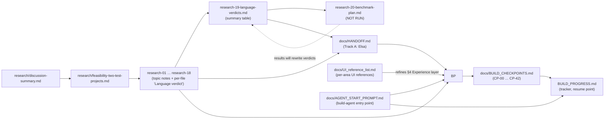
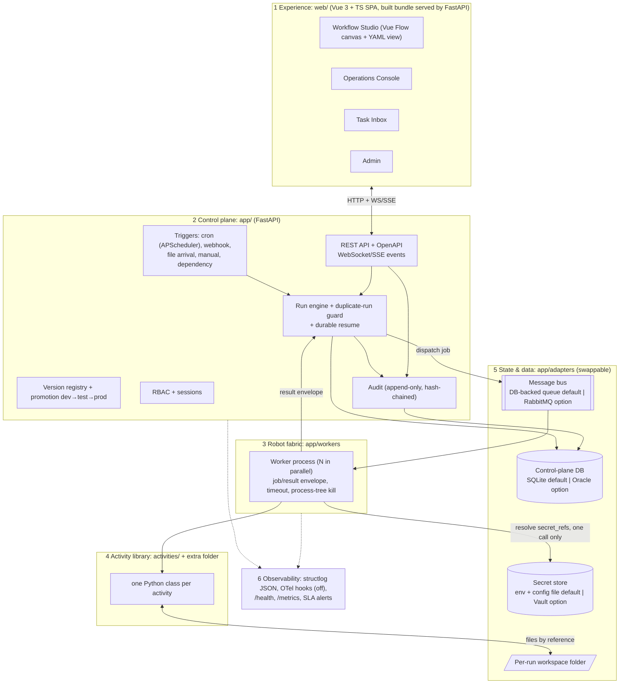
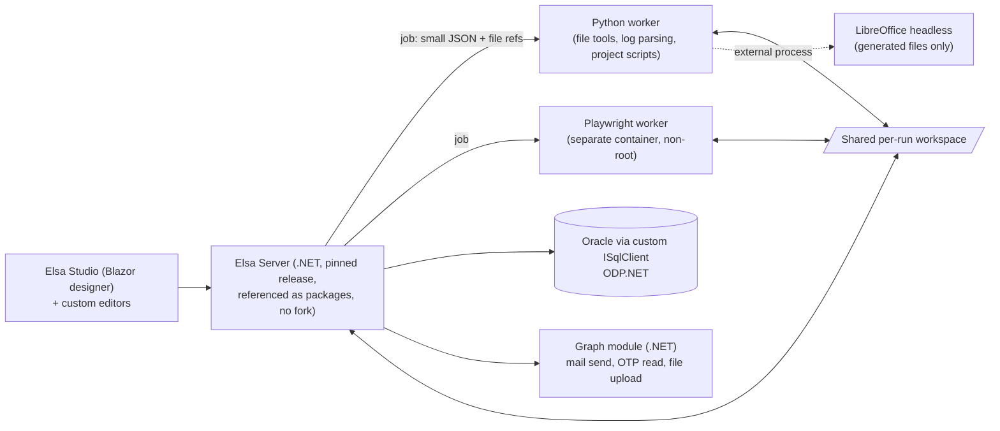
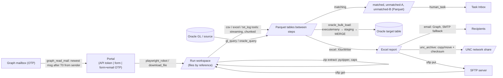

# SYSTEM_DESIGN: Workflow-Builder (WorkTree) repository

Written 2026-10-22 from a complete read of every file in `c:\Users\USER\Code\Workflow-Builder` (27 files). Target reader: an AI coding agent that will maintain and extend this repository.

---

## 0. Read this first: current state of the repository

1. **The repository contains no executable code.** It contains 26 Markdown files. There are no source modules, scripts, schedulers, `.bat` files, configuration files, database schemas, tests, lock files, or build files. The workspace is not a git repository.
2. Everything this document says about "the system" (control plane, workers, activities, tables, triggers) is a **specification written in the docs**, not running behaviour. Treat every such item as **NOT IMPLEMENTED** until `BUILD_PROGRESS.md` marks the matching checkpoint `done`.
2a. **Build entry point:** `docs/AGENT_START_PROMPT.md` (process: work loop, local git, never stop). Checkpoint definitions: `docs/BUILD_CHECKPOINTS.md` (CP-00 to CP-42). Live progress and resume point: `BUILD_PROGRESS.md` at the repository root.
3. The docs describe **two build tracks** for the same product idea:
   - **Track A, "Elsa track":** build on top of **Elsa Workflows (.NET)**, extended with workers. Source: `docs/HANDOFF.md` plus `docs/research/*.md`. This matches the reference .NET stack.
   - **Track B, "Python MVP track":** build a **standalone engine in Python/FastAPI** with a Vue 3 frontend, and do **not** build on Elsa, Temporal, n8n, Airflow or Prefect. Source: `docs/BUILD_PROMPT_python_mvp.md:32`. It reuses the research findings but replaces the .NET/Elsa parts (`docs/BUILD_PROMPT_python_mvp.md:8`).
4. **Decision (user, 2026-10-22): build Track B.** The user's direction, verbatim: "we are to build on python using elsa ideas and n8n as reference", then "elsa is the major workflow reference, n8n is also a reference, not just UI".
   - Build everything in Python (FastAPI backend), following `docs/BUILD_PROMPT_python_mvp.md`.
   - **Elsa is the primary workflow reference** (user, 2026-10-22). Model the engine on Elsa's concepts: activities with typed inputs/outputs and named outcomes, flowchart routing by outcome, bookmarks for suspend/resume, retry strategies, workflows reused as activities with version pinning, scheduling recovery, and single-activity test runs. The Elsa material is `docs/HANDOFF.md` and the Elsa parts of `docs/research/*.md`. The full list is in §11 R34. Do not take Elsa as a package or runtime dependency (`BUILD_PROMPT:32`). Adapting Elsa code (MIT) is allowed only if the notice is kept and the adaptation is recorded in `DECISIONS.md` (`BUILD_PROMPT:104`).
   - **n8n is a secondary reference for both workflow behaviour and UX** (user, 2026-10-22; `BUILD_PROMPT:75,103`). Workflow ideas include one node per tool with an operation dropdown, credentials chosen from saved connections, error-output routing, a separate code node, file data passed by reference, and shared storage for multiple workers. UX ideas include the canvas, the node details view, and execution data on nodes. The full list is in §11 R35. Never copy its code, node definitions, icons or wording (Sustainable Use License; `BUILD_PROMPT:104`).
   - **Precedence when Elsa and n8n ideas conflict:** for engine and workflow semantics, Elsa wins (the user named it the major reference). For anything on the Studio canvas, n8n wins (`BUILD_PROMPT:77`). In every case, the explicit text of `BUILD_PROMPT_python_mvp.md` overrides both references.
   - Use `docs/UI_reference_list.md` as the per-area UI reference list for the experience layer (§3.4).
   - Library and measurement findings in the research notes still apply to Track B wherever they concern Python. Ignore the .NET verdicts (Graph, Oracle, Serilog, Playwright platform blocks), because Track B builds those in Python (`BUILD_PROMPT:56-59,84`).
   - Record this decision as the first entry in `DECISIONS.md` when the build starts (`BUILD_PROMPT:3,122,127`).
   - The decision is written into the source docs as well:
     - `docs/BUILD_PROMPT_python_mvp.md:125-191` ("Workflow reference model: Elsa first, n8n second", with Elsa → Python and n8n concept tables, precedence and UI-reference rules). In-place edits at lines 3, 32, 77 and 101-103.

### Label legend used in this document

| Label | Meaning |
|---|---|
| *(no label + citation)* | Fact directly visible in a file in this repository. |
| **[SPEC]** | A requirement or design written in a repo doc. Nothing implements it. |
| **[RESEARCH]** | A claim recorded in a research note about external software (Elsa source, libraries) or about a sandbox measurement. It cannot be checked from this repository. |
| **[INFERRED]** | My inference. It is not stated directly in any file. |
| **[UNKNOWN]** | Cannot be determined from the repository. Listed again in §13. |
| **[CONFLICT]** | Two repo files disagree. |

Citation format: `path:line` or `path:start-end`. Line numbers refer to the files as of 2026-10-22.

---

## 1. Purpose & Scope

The repository is the **planning and specification set for WorkTree**. WorkTree is an on-premise automation platform. It is meant to replace hand-written Python automations triggered by Windows Task Scheduler and to scale to hundreds of automations over time (`docs/BUILD_PROMPT_python_mvp.md:11`). The platform has three audiences. Engineers compose workflows from reusable activities, process owners trigger, monitor and action runs, and governance covers every run through audit, vaulted secrets and segregation of duties. The repository currently holds:

- 23 research notes (Elsa capabilities, libraries, language verdicts, measurements),
- a handoff summary for the Elsa track (now reference material only, see §0.4),
- a build prompt for the Python MVP track (the active track),
- a UI reference list naming the products to study per experience-layer area.

Out of scope for this repository today: the existing production automations (not present), any production system, and the benchmark plan file `benchmark-plan-all-languages.md` (referenced but absent; `docs/HANDOFF.md:102`, `docs/research/research-20-benchmark-plan.md:6`).

---

## 2. File Inventory

Pass 1 result: 3 directories (`.`, `docs/`, `docs/research/`), 27 files. A re-check on 2026-10-22 found 1 more file (`docs/UI_reference_list.md`, added by the user), making 28 source files plus this document. Every file was read in full.

| Path | Type | Purpose | Used by (referenced from) |
|---|---|---|---|
| `docs/HANDOFF.md` | Markdown | Track A briefing, now titled "HANDOFF (Elsa reference)": goal, constraints, workload, Elsa-based architecture, per-tool language verdicts, Elsa "exists vs build" list, secrets design, risks, open questions, start point. States "nothing has been built or run yet" (line 3). Since 2026-10-22, superseded lines are marked in place (lines 3, 7, 9-11, 14, 98), and section 11 at the end maps every section to the Python build. | `docs/BUILD_PROMPT_python_mvp.md:3` (cited as `HANDOFF.md`, without the `docs/` prefix) |
| `docs/BUILD_PROMPT_python_mvp.md` | Markdown | Track B build prompt: full functional spec, constraints, engineering standards and acceptance tests for a Python/FastAPI + Vue 3 MVP. **Active spec.** Lines 125-191 (added 2026-10-22): workflow reference model (Elsa first, n8n second) and UI-reference rules. | Nothing references it. It is an entry document. |
| `docs/AGENT_START_PROMPT.md` | Markdown | Paste-in start prompt and operating rules for the build agent: read order, resume procedure, work loop, never-stop rules, local-git rules, tracker rules, environment notes, definition of done. | `BUILD_PROMPT:3`; `BUILD_PROGRESS.md`; `HANDOFF:98` |
| `docs/BUILD_CHECKPOINTS.md` | Markdown | 43 ordered resume checkpoints (CP-00 to CP-42). Each has its build items, a "Done when" test and a commit message, covering all of `BUILD_PROMPT` including A1-A10. | `BUILD_PROMPT:3`; `docs/AGENT_START_PROMPT.md`; `BUILD_PROGRESS.md` |
| `BUILD_PROGRESS.md` (repo root) | Markdown | Progress tracker and resume point: current checkpoint, next action, status table with commit and verification evidence, work in progress, blockers, session log. Created as a template (all `todo`). | `docs/AGENT_START_PROMPT.md` |
| `docs/UI_reference_list.md` | Markdown, 44 lines | UI reference products per experience-layer area (9 areas: app shell, operations dashboard, run detail, Studio canvas, node properties panel, Task Inbox, data views, page-like detail, admin/audit), each with the specific feature to study. | `BUILD_PROMPT:3,77,186-191`; §3.4 of this document |
| `docs/research/discussion-summary.md` | Markdown | 2026-09-29 discussion: Elsa as base, worker model, extend-before-fork rule. Its Elsa claims were unverified at the time (line 32). | `docs/HANDOFF.md:3,102` |
| `docs/research/feasibility-two-test-projects.md` | Markdown | Elsa code read (`elsa-core 8fadf47`, `elsa-extensions 212dc55`) against the two reference projects: exists / missing table. | `docs/HANDOFF.md:3,102` |
| `docs/research/research-01-portal-login-mfa.md` | Markdown | Login types and automatability, Playwright session notes, Elsa `UserTask`, Playwright language verdict. | `docs/HANDOFF.md:102`, `research-19:22` |
| `docs/research/research-02-graph-otp-and-playwright-hosting.md` | Markdown | Graph OTP mail query rules, mailbox scoping (RBAC for Applications), OTP timing rules, Playwright container hosting, Graph language verdict. | `docs/HANDOFF.md:102`, `research-19:22-23` |
| `docs/research/research-03-oracle.md` | Markdown | Elsa SQL providers, Oracle `ISqlClient` extension, ODP.NET / python-oracledb, bulk-load options, Oracle verdict. | `docs/HANDOFF.md:102`, `research-19:24` |
| `docs/research/research-04-large-files.md` | Markdown | Memory measurements for 3M-row files, Elsa `ReadCsv` behaviour, "pass paths not rows" rule. | `docs/HANDOFF.md:102`, `research-19:24` |
| `docs/research/research-05-excel.md` | Markdown | Excel libraries, licences, 500k-row measurements, edit-fidelity tests, Excel verdict (Python). | `docs/HANDOFF.md:102`, `research-19:12` |
| `docs/research/research-06-csv.md` | Markdown | CSV libraries, 3M-row measurements, messy-file tests, CSV verdict (Python, low confidence; open vs .NET). | `docs/HANDOFF.md:102`, `research-19:13` |
| `docs/research/research-07-txt.md` | Markdown | Text streaming, fixed-width, encodings, TXT verdict. | `docs/HANDOFF.md:102`, `research-19:14` |
| `docs/research/research-08-zip.md` | Markdown | ZIP/AES/7z libraries, zip-slip tests, ZIP verdict and LGPL flip condition. | `docs/HANDOFF.md:102`, `research-19:15` |
| `docs/research/research-09-html.md` | Markdown | HTML parse/generate libraries, Playwright for JS pages, HTML verdict. | `docs/HANDOFF.md:102`, `research-19:16` |
| `docs/research/research-10-word.md` | Markdown | Word libraries, capability tests, TOC gap, Word verdict. | `docs/HANDOFF.md:102`, `research-19:17` |
| `docs/research/research-11-pptx.md` | Markdown | PowerPoint libraries, capability tests, PPTX verdict. | `docs/HANDOFF.md:102`, `research-19:18` |
| `docs/research/research-12-logs.md` | Markdown | Log parsing measurements; own-logging choice (Serilog/structlog + shared JSON fields). | `docs/HANDOFF.md:102`, `research-19:19-20` |
| `docs/research/research-13-libreoffice-engine.md` | Markdown | LibreOffice licence, CVEs, operating rules (own profile, timeout, no network). | `docs/HANDOFF.md:102`, `research-19:21` |
| `docs/research/research-14-nodes-per-file-tool.md` | Markdown | One node per file tool, Elsa form controls, script/guided/hybrid modes, shared node contract. | `docs/HANDOFF.md:102`, `research-19:36` |
| `docs/research/research-15-n8n-make-powerautomate-vs-elsa.md` | Markdown | UX expectations (n8n/Make/Power Automate) vs Elsa features. | `docs/HANDOFF.md:102`, `research-19:36` |
| `docs/research/research-16-growing-node-library.md` | Markdown | Three ways to add nodes in Elsa, versioning, organisation by category, credentials as inputs. | `docs/HANDOFF.md:102`, `research-19:36` |
| `docs/research/research-17-secrets.md` | Markdown | Elsa Secrets module, `ConfigurationSecretStore` lean, weak spots. | `docs/HANDOFF.md:102`, `research-19:36` |
| `docs/research/research-18-elsa-gaps.md` | Markdown | Release vs `main`, security findings, resilience, errors, scheduling, single-node test, data mapping. | `docs/HANDOFF.md:102`, `research-19:36` |
| `docs/research/research-19-language-verdicts.md` | Markdown | One-page verdict table per tool, plus Hope's 2026-09-30 decisions (JavaScript out, "anything you can do with the file"). | `research-14:37`, `research-15:36`, `research-16:45`, `research-20:20` |
| `docs/research/research-20-benchmark-plan.md` | Markdown | Description of a 321-test benchmark plan (WRITTEN, NOT RUN) that should produce `RESULTS.xlsx` and `HANDBACK.md`. | `docs/HANDOFF.md:53`, `research-13:37`, `research-19:48,52` |

This document (`docs/SYSTEM_DESIGN.md`) was added after the inventory. It is not counted in the 27 files.

Files I could not read or did not fully understand: **none**.

Files that docs reference but that **do not exist** in the repository:

| Referenced file | Referenced at | Status |
|---|---|---|
| `benchmark-plan-all-languages.md`, its `ops/` folder, `py/lo.py` | `docs/research/research-20-benchmark-plan.md:6,14,17`; `docs/HANDOFF.md:102` | Absent (never attached, per HANDOFF) |
| `RESULTS.xlsx`, `HANDBACK.md` | `research-20:6,25` | Absent (benchmark not run) |
| `DECISIONS.md`, `KNOWN_GAPS.md`, `LICENSES.md`, `README.md`, `config.yaml`, `docs/ENVELOPE.md`, `docs/WRITING_AN_ACTIVITY.md`, `docs/design-language.md`, `docs/SECURITY.md`, `docs/adr/`, `activities/_template.py`, `uv.lock`, `package-lock.json` | `docs/BUILD_PROMPT_python_mvp.md:3,33,55,68,77,89,92,96,97,121-122` | Absent ([SPEC] deliverables of Track B) |

---

## 3. Architecture Overview

### 3.1 Actual architecture: a document set

The precedence between the documents follows from their dates and supersede notes:
- `research-19` overrides the "Python worker" wording in research 01-18. Read "Python worker" as "the worker for the language that wins that tool" (`research-19:36`).
- `research-19:38-48` (Hope's decisions of 2026-09-30) overrides the earlier tiebreaks in research-06 and research-11.
- `docs/HANDOFF.md` (2026-10-22) summarises research 01-20 for Track A (`docs/HANDOFF.md:3`).
- `docs/BUILD_PROMPT_python_mvp.md` overrides the stack choice (`docs/BUILD_PROMPT_python_mvp.md:8,32`). Since the user's decision of 2026-10-22 (§0.4), it is the governing spec. `docs/HANDOFF.md` is reference material.
- `docs/UI_reference_list.md` adds detail to `BUILD_PROMPT:70-82` (experience layer). Where they overlap, the BUILD_PROMPT precedence rule still decides (§3.4).

### 3.2 Specified architecture, Track B (Python MVP) [SPEC]

Six layers (`docs/BUILD_PROMPT_python_mvp.md:21-27`), module layout (`:120`).

### 3.3 Track A architecture (Elsa): REFERENCE, do not build as-is [RESEARCH]

Elsa is the primary workflow reference (§0.4), so this diagram shows the shape the Python engine re-implements in its own code. The mapping: Elsa Server becomes the FastAPI control plane plus run engine; Studio becomes the Vue Workflow Studio; worker jobs become the job/result envelope; the `ISqlClient` Oracle provider becomes the DB adapter; the Graph module becomes the `email`/`graph_read_mail` activities. Do not run Elsa or build .NET components (§0.4).

Sources: `docs/HANDOFF.md:26-34,57-66,98`.

### 3.4 Experience layer: pages and UI references [SPEC]

The pages come from `BUILD_PROMPT:78-81`. The base components are our own Vue components on native HTML elements, styled by our own design tokens (`docs/design-language.md`; this replaced the Fluent UI Web Components of `BUILD_PROMPT:71` on 2026-11-06, DECISIONS 13.1). Reference products per area come from `docs/UI_reference_list.md` (line numbers in brackets).

| UI area | Page(s) it serves (`BUILD_PROMPT`) | Reference products and what to study (`UI_reference_list.md`) | Style that wins a conflict (`BUILD_PROMPT:77`) |
|---|---|---|---|
| App shell, navigation, command palette | All pages; Ctrl/Cmd+K palette and `/` menu (`:76`) | Notion: collapsible sidebar tree, Ctrl/Cmd+K, `/` menu. Linear: keyboard-first navigation, clean palette. Azure portal / Fabric: nav rail, breadcrumbs, resource pages. (`:1-4`) | Notion (navigation, page layout, feel) |
| Operations dashboard and run history | Console dashboard, run history with filters (`:78`) | Temporal Web UI: workflow list with status filters, dense table. GitHub Actions: run list with status icons, durations, quick filters. Airflow: grid and status views across workflows and runs. (`:6-9`) | Microsoft (dense operational data) |
| Run detail | Live step timeline, masked logs, artifacts (`:78`) | GitHub Actions run page: collapsible steps, live logs, artifacts. n8n executions view: replay a run on the canvas with data at each node. Temporal event history: precise ordered record. (`:11-14`) | Microsoft for the timeline/log table; n8n for canvas replay |
| Studio canvas | Workflow Studio, Vue Flow canvas (`:80`) | n8n: node cards, typed connections, execution data on nodes. Make: scenario canvas, routers and branching. Power Automate designer: the Microsoft flavour colleagues know. (`:16-19`) | n8n (anything on the canvas) |
| Node properties panel and generated forms | Schema-generated form, output-mapping picker, secret dropdown, single-step run (`:80`) | n8n node details view: input/output data beside the settings. Power Automate action pane: typed fields and a dynamic-content picker. Make module settings: field mapping from earlier steps. (`:21-24`) | n8n (canvas-attached panel) |
| Task Inbox | Claim/complete with reason, four task types, SLA countdown, overdue view (`:79`) | Camunda Tasklist: claim, complete, assignment by role. Power Automate approvals centre: approve/reject with a recorded reason. Linear inbox: triage feel, keyboard shortcuts. (`:26-29`) | Microsoft (operational data, accessibility) |
| Data views | List/table/board/gallery views, saved filters (`:76`) | Notion databases: one dataset as table, board or gallery with saved views. Airtable: grid, filters, grouping. Linear: fast list/board views with saved filters. (`:31-34`) | Microsoft for grids; Notion for view switching [INFERRED] |
| Page-like detail | Workflow / run / task as a page with editable title, properties, notes (`:76`) | Notion: editable title, properties, free-text notes. Linear issue pages: properties in a side column, activity feed below. GitHub issue/PR pages: timeline beside metadata. (`:36-39`) | Notion |
| Admin, roles and audit log | Users and roles, environments, secrets metadata, audit viewer with chain verification (`:81`) | Microsoft Entra admin center: roles, groups, access reviews. GitHub org settings and audit log: searchable, filterable event log. HashiCorp Vault UI: secrets metadata, never values. (`:41-44`) | Microsoft |

Rules for using these references:
- Take ideas and interaction patterns only. Build our own design tokens, icons and wording. `BUILD_PROMPT:73` forbids reusing assets, branding or code from n8n, Notion or Microsoft. No UI library is used; icons are Phosphor (MIT), copied by a generator. [INFERRED] Apply the same rule to every product in `docs/UI_reference_list.md` (Linear, Temporal, GitHub, Airflow, Make, Power Automate, Camunda, Airtable, Entra, Vault, Azure/Fabric).
- Use each product only in the area it is listed under. When references disagree, `docs/design-language.md` decides (DECISIONS 13.1-13.8); the old Microsoft, n8n, Notion conflict order no longer applies.
- Record the chosen patterns and tokens in `docs/design-language.md` (`BUILD_PROMPT:77`).

---

## 4. Entry Points & Execution Flow

### 4.1 Actual entry points

**None.** Pass 1 found no runnable file: no `*.py`, `*.cs`, `*.ts`, `*.bat`, `*.ps1`, `*.sh`, no scheduler definitions, no `Program.cs`, no `pyproject.toml`. Do not look for a scheduler or service in this repository. None exists.

### 4.2 Specified entry points, Track B [SPEC]

| Entry point | Trigger | Spec source |
|---|---|---|
| CLI `serve` | Operator starts the platform | `BUILD_PROMPT:89` |
| CLI `validate <workflow>` | Manual | `BUILD_PROMPT:89` |
| CLI `run <workflow>` | Manual | `BUILD_PROMPT:89` |
| CLI `list-activities` | Manual | `BUILD_PROMPT:89` |
| CLI `verify-audit` (also an HTTP endpoint) | Manual | `BUILD_PROMPT:50,89` |
| CLI `create-user` | Manual | `BUILD_PROMPT:89` |
| REST API (workflows, versions, environments, runs, tasks, schedules, users/roles, audit, secrets metadata, artifacts) | HTTP | `BUILD_PROMPT:42` |
| `/health`, `/metrics` (Prometheus text) | HTTP | `BUILD_PROMPT:86` |
| Trigger: cron | APScheduler; missed runs skipped by default, `catch_up: true` optional per workflow | `BUILD_PROMPT:45` |
| Trigger: webhook | Per-workflow token | `BUILD_PROMPT:45` |
| Trigger: file arrival | Watch a folder/UNC path | `BUILD_PROMPT:45` |
| Trigger: manual | "Run now" | `BUILD_PROMPT:45,78` |
| Trigger: dependency | Another workflow finishes with a given outcome | `BUILD_PROMPT:45` |
| Worker process | Pulls jobs from the bus | `BUILD_PROMPT:68` |

Startup rule: refuse to start when admin credentials are empty or default (`BUILD_PROMPT:49`).

**Specified run flow** (`BUILD_PROMPT:29,46-48,51,68`):
1. A trigger fires (cron, webhook, file arrival, manual or dependency).
2. The duplicate-run guard checks whether the same workflow (or the configured key within it) is already running. If so, it rejects or queues the trigger according to the setting and records the reason.
3. The control plane creates a run record in the DB with a run id, a correlation id and a per-run workspace folder. In prod, only promoted versions may run.
4. For each step, the engine puts a job envelope `{run_id, step_id, activity, inputs, secret_refs, workspace}` on the bus.
5. A worker pulls the job, resolves `secret_refs` from the secret store for this one call only (passed to the child by stdin/env), and runs the activity in a separate OS process with a timeout. On timeout it kills the process tree.
6. The activity returns `{outcome: done|failed, outputs, message, artifacts}` and never raises.
7. The engine persists run state after every step, emits a step event over WebSocket/SSE (≤ 5 s to the console), writes audit rows, and routes to `on_done` or `on_failed`.
8. A `human_task` step creates a task and suspends the run. Completing the task records the decision and reason and resumes the run.
9. On a control-plane restart, interrupted runs resume from the last completed step. A step marked `resume: restart` re-runs. `resume: skip` is also specified.

### 4.3 Track A entry points: REFERENCE [RESEARCH]

These are Elsa's entry points. They are the model for the Track B equivalents in §4.2 (Elsa `Cron`/`Timer`/`StartAt` become the cron trigger; `UserTask` becomes `human_task`; `POST /tests/activities` becomes single-step run in Studio). Do not build them in .NET (§0.4).

- Elsa Server + Studio from a pinned release, in our own solution that references Elsa as packages (`HANDOFF:98`).
- Elsa trigger activities `Cron`, `Timer`, `StartAt`, `Delay`. The default `LocalScheduler` is in-memory and rebuilds schedules from stored triggers at startup (`research-18:57-58`).
- `UserTask` suspends a workflow with a bookmark until a person completes it (`research-01:27`).
- Single-node test: `POST /tests/activities` from the Studio Test tab. It runs the node for real, with no dry run (`research-18:69-75`).

### 4.4 Business flows the system must support

**Current state, not in this repo** (`BUILD_PROMPT:11`): portal login (Selenium/Firefox, OTP via Graph) → Oracle GL/source query → bespoke logic → Excel report → email → UNC archive, triggered by Windows Task Scheduler on dedicated servers.

**Reference project 1** (`HANDOFF:19`): read Excel → compute/format Excel/CSV → deliver to a network share or via Graph API.

**Reference project 2** (`HANDOFF:20`): download files from a portal → format → load to an Oracle table. In Track B, acceptance scenario 1 (below) covers both reference projects' patterns against local fixtures.

**Track B acceptance scenario 1** (`BUILD_PROMPT:108`): portal login with email OTP → download a password-protected ZIP containing a 1M-row CSV → extract → query GL (SQLite) → match against the CSV → Excel report → email via fake Graph → archive to a "UNC" folder with a checksum. Peak worker memory stays under 500 MB.

---

## 5. Data Flow [SPEC]

Nothing flows today. The specified flows are below.

| Source | Transformation | Destination | Spec source |
|---|---|---|---|
| Portal files (via browser or HTTP) | Login, download | Run workspace | `BUILD_PROMPT:57,59` |
| Graph mailbox | Read newest message since a timestamp from a sender; extract code by configurable regex | Login step input | `BUILD_PROMPT:57,59`; `research-02:9-11,22-24` |
| ZIP (AES-256) | Extract with zip-slip protection and size/count caps | Workspace | `BUILD_PROMPT:58` |
| CSV / Excel / TXT / logs | Stream or chunk; declared encodings; `read_fwf(dtype=str)` | Parquet in workspace | `BUILD_PROMPT:55,58` |
| Oracle GL / source | Parametrised SQL with named binds | Parquet / small JSON | `BUILD_PROMPT:56` |
| Two tables | Key match with amount/date tolerance, 1:1 or 1:N | matched / unmatched-A / unmatched-B Parquet → tasks | `BUILD_PROMPT:61` |
| Parquet / CSV | Chunked `executemany` into staging, then MERGE, per-row error report | Oracle table | `BUILD_PROMPT:56`; `research-03:22-24` |
| Report file | Send / archive | Email (Graph or SMTP), UNC share (checksum verified), SFTP | `BUILD_PROMPT:57` |
| Document | `ai_extract` via an internal LLM endpoint (off by default) | Small JSON | `BUILD_PROMPT:63` |

Platform-internal data: run state, tasks, versions and audit go to the control-plane DB. Step events go to the console over WebSocket/SSE. Logs go to rotating structlog JSON files (`BUILD_PROMPT:84`).

---

## 6. Data Contracts

### 6.1 Job / result envelope, Track B [SPEC] (`BUILD_PROMPT:47,68,94`)

| Direction | Field | Type / values |
|---|---|---|
| in | `run_id` | run identifier |
| in | `step_id` | step id from the workflow definition |
| in | `activity` | activity name |
| in | `inputs` | small JSON (file references, not file contents) |
| in | `secret_refs` | secret names, resolved by the worker for one call |
| in | `workspace` | per-run workspace folder path |
| out | `outcome` | `done` \| `failed` |
| out | `outputs` | small JSON |
| out | `message` | safe message (secrets masked) |
| out | `artifacts` | file references |

Rules: the envelope is language-neutral and documented as a versioned JSON Schema in `docs/ENVELOPE.md`. Contract tests apply to every activity and to any future worker (`BUILD_PROMPT:68,94`). Exact JSON types, the schema version field and the correlation-id field placement are [UNKNOWN]. The correlation id is required on every log line (`BUILD_PROMPT:47`).

### 6.2 Node contract, Track A [SPEC] (`HANDOFF:28`; `research-14:20-24`)

- Inputs: small JSON plus file references into a per-run workspace.
- Outputs: file references plus a small result summary (row counts, sheets, warnings).
- Outcomes: named `Done` / `Failed`, so the Flowchart can route errors.
- Every node has a timeout and a correlation id and emits the same structured JSON log fields.
- Secrets are passed for one call only and never written to the shared workspace.

### 6.3 Activity interface, Track B [SPEC] (`BUILD_PROMPT:55`)

- Attributes: `name`, `category`, pydantic input schema.
- Method: `run(ctx, inputs) -> ActivityResult(outcome, outputs, message, artifacts)`.
- Never raises to the engine. On error it returns `failed` with a safe message.
- Discovery: the `activities/` package plus a configurable extra folder, with generated docs.
- The type of `ctx` and its members are [UNKNOWN] (not specified).

### 6.4 Workflow definition, Track B [SPEC] (`BUILD_PROMPT:43`)

Format: YAML/JSON graph of steps. It has a versioned JSON Schema in `docs/` (`BUILD_PROMPT:94`).

| Step field | Meaning |
|---|---|
| `id` | step id |
| activity type | activity name (exact key name [UNKNOWN]) |
| `inputs` | literal values or references, e.g. `{{ steps.download.files[0] }}`, `{{ secret:portal_x_password }}` |
| `on_done` / `on_failed` | next step by outcome |
| `timeout_seconds` | per-step timeout |
| `retries` | count, delay, backoff |
| `resume` | `restart` \| `skip` (`BUILD_PROMPT:47`) |

Also required: branching, `foreach` over small lists, sub-workflow call. Validation before save rejects an unknown activity, a bad reference, an unreachable step and a cycle. Per-workflow settings that are mentioned but whose key names are not given: `catch_up` (given), duplicate-guard mode and key, SLA expected completion time, owner, environment, tags, description ([UNKNOWN] key names).

### 6.5 Persistence (DB tables) [SPEC]

- **No table or column names are specified anywhere.** [UNKNOWN]
- Entities implied by the API resource list (`BUILD_PROMPT:42`) [INFERRED]: workflows, workflow versions (immutable), environments (`dev`, `test`, `prod`), runs, steps/step state, tasks, schedules, users, roles, audit, secrets metadata (names, last rotated; never values), artifacts.
- The audit table is append-only. Each row is hash-chained to the previous one and records who, what, when, from where, and before/after for config changes. No update or delete path may exist in code. Retention is configurable with a default of 7 years (`BUILD_PROMPT:50`).
- Schema changes go through Alembic migrations only (SQLAlchemy 2.x) (`BUILD_PROMPT:93`).
- Indexes must be sufficient for dashboard p95 ≤ 2 s with 5,000 runs (`BUILD_PROMPT:48,115`).
- Reference-design control-plane DB: Oracle. Its schema is [UNKNOWN].
- Business tables read and written (GL, recon tables, Oracle load targets): names [UNKNOWN]. The recon engine's Oracle tables "stay untouched" during the legacy-screen transition.

### 6.6 Input file formats [SPEC]/[RESEARCH]

| Format | Facts the code must respect | Source |
|---|---|---|
| CSV | Thousands to a few million rows. BOM, quoted commas, embedded newlines and ragged rows occur. Declare the encoding per source; detection is only a fallback (cp1252 was misdetected as cp1250). | `HANDOFF:22`; `research-06:15-18` |
| Excel `.xlsx` | Max 1,048,576 rows per sheet. Formulas are stored without calculated values (readers see 0/None) unless recalculated. | `research-05:31,38` |
| Fixed-width TXT | `pandas.read_fwf(..., dtype=str)` keeps leading zeros | `research-07:5` |
| ZIP | AES-256 password zips occur. Stdlib `zipfile` cannot open them; pyzipper can. | `research-08:6-7` |
| OTP email | Graph returns HTML bodies by default. `$orderby` properties must also appear first in `$filter`. | `research-02:10-11` |
| Tables between steps | Parquet | `BUILD_PROMPT:55` |
| Cross-language values (Track A rule to adopt, untested) | money as strings or fixed-scale decimals, ISO 8601 dates, explicit nulls, Parquet/Arrow | `HANDOFF:84` |
| Portal file formats, real column layouts | [UNKNOWN] | none |

### 6.7 Duplicate-prevention and idempotency logic [SPEC]

1. **Duplicate-run guard:** the same workflow, or a configured key within it, cannot run twice at once. A second trigger is rejected or queued according to the setting, and the reason is recorded (`BUILD_PROMPT:46`).
2. **Idempotency keys** on mutating API endpoints that triggers may retry (`BUILD_PROMPT:94`).
3. **Resume semantics:** steps must be idempotent or declare `resume: restart|skip` (`BUILD_PROMPT:47`).
4. **OTP:** record the time before triggering the login, take only the newest message after that time from the portal's sender, and serialise logins per portal/mailbox (`BUILD_PROMPT:59`; `research-02:22-24`).
5. **Oracle load:** load into staging, then MERGE into the target (`BUILD_PROMPT:56`). The exact MERGE keys are [UNKNOWN].
6. **Archive:** `unc_archive` verifies a checksum after copy/move (`BUILD_PROMPT:57`).
7. **Audit:** a hash chain detects tampering (`BUILD_PROMPT:50`).
8. **Missed cron runs:** skipped by default; `catch_up: true` per workflow (`BUILD_PROMPT:45`). Track A: Elsa staggers past-due schedules on startup (`research-18:58,64`), and the business decision is open (`HANDOFF:82`).

---

## 7. Shared Utilities

**Actual:** none. The repository has no modules or functions.

**Specified, Track B** [SPEC]. The interfaces must be swappable and injected (`BUILD_PROMPT:37,93`):

| Interface | Default implementation | Optional implementation | Signatures |
|---|---|---|---|
| Database | SQLite (SQLAlchemy 2.x) | Oracle via SQLAlchemy + python-oracledb thin mode | [UNKNOWN] |
| Message bus | Durable in-process / DB-backed queue | RabbitMQ via aio-pika | [UNKNOWN] |
| Secret store | Env vars + optional config file | HashiCorp Vault via hvac | [UNKNOWN] |
| Durable resume | Own DB-backed run state | Temporal adapter (not required) | [UNKNOWN] |
| Clock | Injected (deterministic tests) | none | [UNKNOWN] |
| Audit | Append-only hash-chained writer | none | [UNKNOWN] |
| Activity base | `run(ctx, inputs) -> ActivityResult(outcome, outputs, message, artifacts)` | none | `BUILD_PROMPT:55` |

Dependency direction: API → services → domain → adapters, enforced. No business logic in route handlers (`BUILD_PROMPT:93`).

**Specified activity catalogue, Track B** (`BUILD_PROMPT:56-65`): `gl_query`, `oracle_query`, `oracle_execute`, `oracle_bulk_load`, `http_request`, `download_file`, `sftp` (get/put/list), `email` (Graph client-secret + SMTP fallback), `graph_read_mail`, `unc_archive`, `csv`, `excel`, `zip`, `txt_log`, `playwright_robot`, `playwright_script`, `legacy_robot_wrapper`, `matching`, `human_task` (Approval, Manual Match, Data Entry, Exception Disposition), `ai_extract` (off by default), `run_python`. Out of scope: Word, PowerPoint, HTML.

**Track A extension points: REFERENCE** [RESEARCH]. These are Elsa .NET APIs and the primary design reference for the matching Python interfaces. Mirror their responsibilities in Python and do not call them. The mapping: `IResilientActivity` / `ITransientExceptionStrategy` become per-step `retries` plus a transient-error classifier; `ISecretStore` becomes the swappable secret-store interface; `IActivityProvider` becomes auto-discovery from `activities/` and the extra folder; `ISqlClient` becomes the DB adapter; the `[Input]`/`[Output]` attributes become the pydantic input schema and `ActivityResult.outputs`. The Elsa APIs are:

| Extension point | Use | Source |
|---|---|---|
| `BaseSqlClient` subclass: `CreateConnection()`, `CreateCommand()`; register `client.Register<OracleClient>("Oracle")`; parameter marker `:`; `BindByName = true` | Oracle provider for `SqlQuery`/`SqlCommand`/`SqlSingleValue` | `research-03:7-8`; `HANDOFF:61` |
| `IResilientActivity` + `IResilientActivityInvoker.InvokeAsync(...)`, custom `ITransientExceptionStrategy` (add `OracleException`) | Retries for our nodes | `research-18:32,38-40` |
| `ISecretStore` (or `ConfigurationSecretStore`) | Secrets | `research-17:11-14,32-34` |
| `IActivityProvider` | Catalogue-driven worker nodes | `research-16:10`; `HANDOFF:31` |
| `IDropIn.Install` (`Elsa.DropIns`) | C# drop-in nodes (platform code only) | `research-16:11,43` |
| `[Activity]`, `[Input]`, `[Output]`, `[Input(CanContainSecrets = true)]`, `RefreshOnChange`, UI-hint handler (Blazor) | Node classes and Studio forms | `research-14:8-11`; `research-17:37` |

---

## 8. Configuration & Secrets

No configuration file exists in the repository. Names only; values never appear in any repo file.

| Name | Kind | Track | Source |
|---|---|---|---|
| `config.yaml` | Platform config file (sensible defaults) | B | `BUILD_PROMPT:89` |
| `{{ secret:<name> }}` (e.g. `portal_x_password`) | Secret reference syntax in workflow inputs | B | `BUILD_PROMPT:43` |
| `secret_refs` | Envelope field; resolved per call | B | `BUILD_PROMPT:47,68` |
| Audit retention (default 7 years) | Config value, key name [UNKNOWN] | B | `BUILD_PROMPT:50` |
| `catch_up` | Per-workflow missed-run flag | B | `BUILD_PROMPT:45` |
| AI endpoint URL + enable flag (off by default) | Config, key names [UNKNOWN] | B | `BUILD_PROMPT:35,63` |
| OpenTelemetry enable (off by default) | Config, key name [UNKNOWN] | B | `BUILD_PROMPT:84` |
| Extra activities folder | Config, key name [UNKNOWN] | B | `BUILD_PROMPT:55` |
| OTP code regex | Per-activity input | B | `BUILD_PROMPT:59` |
| Playwright session-state folder (locked down, outside the workspace) | Path | A, B | `BUILD_PROMPT:59`; `HANDOFF:63` |
| `Elsa:Secrets:<key>`, then `<key>` | `ConfigurationSecretStore` lookup order in `IConfiguration` | A | `research-17:11` |
| `SecretsOptions.EncryptionKey` | Static key of the default encrypted store (avoid) | A | `research-17:43`; `HANDOFF:71` |
| `App_Data/elsa-secrets.json` | Default secret repository file of `EncryptedSecretStore` | A | `research-17:33` |
| `PythonOptions.AllowHostCodeExecution`, `CSharpOptions.AllowHostCodeExecution` | Enable in-process code activities (off by default) | A | `feasibility:22-23` |
| `Resilience:Strategies` | Retry strategies config section | A | `research-18:34` |
| `LogPersistenceMode` (Inherit / Include / Exclude) | Controls persisted activity I/O | A | `research-04:19` |
| `PLAYWRIGHT_DOWNLOAD_HOST`, `PLAYWRIGHT_BROWSERS_PATH`, proxy/CA env vars | Playwright on restricted networks | A, B | `research-01:24` |
| `-env:UserInstallation=file:///...` | LibreOffice per-worker profile | A, B | `research-13:15` |

**Credentials the system needs** (names of kinds only; `research-17:7`; `BUILD_PROMPT:57-59`): portal logins (token / username+password / OTP mailbox), Oracle connection credentials (auth method [UNKNOWN]; `HANDOFF:88`), Graph app client secret (expires, so expiry triggers rotation; `HANDOFF:72`), SMTP, network-share access, SFTP, Playwright `storageState` files (treated as credentials; `research-01:21`), local user password hashes (argon2id) and the session signing key (`BUILD_PROMPT:49,96`).

Graph permissions: application `Mail.Read` (`Mail.ReadBasic.All` probably lacks bodies) and `Mail.Send`. Scope them to specific mailboxes with RBAC for Applications in Exchange Online, and remove unscoped Entra consent (`research-02:12-17`; `HANDOFF:62`).

Current team practice: secrets live in "encrypted env vars + config.json". Who decrypts them is [UNKNOWN] (`research-17:11-13`; `HANDOFF:89`).

---

## 9. External Dependencies

### 9.1 Systems and services

| System | Role | Status / source |
|---|---|---|
| Oracle DB ("newer", treat as 19c+) | GL/source queries, ETL targets; reference-design control-plane DB | Version and auth [UNKNOWN]; `HANDOFF:22,88` |
| Microsoft Graph (Entra app, client secret) | OTP mailbox read, mail send, file delivery | Access set up by your security team (`research-03:3`); no call ever made (`HANDOFF:84`) |
| Web portals (API token, form, form+email OTP; push/SMS cannot be unattended) | File downloads | `HANDOFF:22`; `research-01:11-18` |
| SFTP servers | get/put/list | `BUILD_PROMPT:57` |
| UNC network share | Report archive / delivery | `BUILD_PROMPT:57` |
| SMTP | Mail fallback | `BUILD_PROMPT:57` |
| Internal LLM endpoint | `ai_extract` (off by default; pending AI framework approval) | `BUILD_PROMPT:35,63` |
| LibreOffice headless | Formula recalc / PDF on generated files only; optional, off by default in Track B | `BUILD_PROMPT:58`; `research-13:12-18` |
| Windows Task Scheduler | Trigger of today's legacy automations | n/a |
| Elsa Workflows (`elsa-core`, `elsa-studio`, `elsa-extensions`, docs https://docs.elsaworkflows.io) | **Primary workflow/engine reference.** Not a runtime dependency. Code adapted only with the MIT notice and a `DECISIONS.md` entry (§0.4). | `BUILD_PROMPT:102,104` |
| n8n (https://github.com/n8n-io/n8n, https://docs.n8n.io) | **Secondary reference for workflow behaviour and UX.** Sustainable Use License, not open source: no code, node definitions, icons or wording; no dependency. | `BUILD_PROMPT:103-104` |
| Products in `docs/UI_reference_list.md` | UI pattern references only (§3.4) | `docs/UI_reference_list.md:1-44` |

### 9.2 Libraries named by Track B [SPEC] (`BUILD_PROMPT:32-98`)

Backend: Python 3.11+, FastAPI, SQLAlchemy 2.x, Alembic, pydantic, python-oracledb (thin), APScheduler, aio-pika (optional), hvac (optional), structlog, OpenTelemetry (hooks), argon2 or bcrypt (argon2id named in standards), Playwright (Python), pyzipper, python-calamine, openpyxl, XlsxWriter, pandas/polars, `read_fwf`, Parquet (library [UNKNOWN]; pyarrow per `research-06:6` [INFERRED]). Tooling: uv, ruff, mypy `--strict`, pytest, Hypothesis, pip-audit, pre-commit.
Frontend: Vue 3 + TypeScript strict, Vite, Vue Router, Pinia, `@tanstack/vue-query`, `@vue-flow/core`, vue-tsc, ESLint, Vitest, Playwright (E2E), npm audit. A generated TS API client from OpenAPI; CI fails if it is stale.

### 9.3 Licence flags recorded in research [RESEARCH]

- **Avoid (commercial or GPL issues):** EPPlus (Polyform Noncommercial), Xceed DocX (non-commercial), NPOI (maintenance fee), pygtail (GPL v2), pyxlsb (LGPL, unmaintained) (`research-05:19-20`; `research-10:24-25`; `research-12:11`).
- **Needs a legal ruling:** LGPL py7zr, docxtpl and paramiko; the ODP.NET licence text; LibreOffice MPL-2.0 under the "libraries yes, products no" rule (`HANDOFF:80-81`; `research-19:51-52`).
- Track B rule: prefer MIT/BSD/Apache and keep `LICENSES.md` (`BUILD_PROMPT:33`).

---

## 10. Error Handling, Logging & Re-runs

**Actual:** not applicable (no code).

**Specified** [SPEC]:

| Concern | Rule | Source |
|---|---|---|
| Activity failure | Never raise to the engine. Return `failed` + safe message. Route via `on_failed`. | `BUILD_PROMPT:43,55` |
| Elsa node failure (A) | Elsa has no Try/Catch. Each node catches its own exceptions and completes with a named `Failed` outcome. | `HANDOFF:65`; `research-18:51` |
| Retries | Per step: count, delay, backoff (B). `IResilientActivity` + own strategies (A). | `BUILD_PROMPT:43`; `HANDOFF:64` |
| Timeouts | Per step. Kill the process tree on timeout, then route through `on_failed`. A hung worker must never take down the control plane. | `BUILD_PROMPT:47,111` |
| Crash recovery | Persist after every step. Resume from the last completed step. `resume: restart` re-runs a step. | `BUILD_PROMPT:47,111` |
| Logging | Structured JSON (structlog), rotating files, correlation id on every line. Track A: Serilog in the runner, with the same JSON fields in workers. | `BUILD_PROMPT:84`; `HANDOFF:47` |
| Secret masking | At every sink: logs, run records, API responses, UI, stdout/stderr of wrapped scripts. A test greps for planted secret values. | `BUILD_PROMPT:60,85,113` |
| Errors to clients | No stack traces. Consistent error format. | `BUILD_PROMPT:94,96` |
| Alerts | SLA breach (task or workflow): in-app plus configurable email/webhook, and an overdue view. | `BUILD_PROMPT:51-52` |
| Rerun safety | Re-runs are safe only for steps that are idempotent or declare `resume`. The duplicate-run guard blocks concurrent re-runs. Elsa's Test tab runs nodes for real (not dry-run safe). | `BUILD_PROMPT:46-47`; `research-18:74` |

---

## 11. Invariants / Do-Not-Break Rules

Apply these to every change. R-numbers are for reference in reviews.

**Repository and documentation**
- R1. Never present a research verdict as final. Verdicts are to be rewritten from benchmark results (`HANDOFF:53`; `research-20:25`). Keep evidence tags `[measured]`, `[tested]`, `[docs]`, `[reasoning]` in research notes (`research-19` and every "Language verdict" section).
- R2. Read "Python worker" in research 01-18 as "the worker for that tool's winning language" (`research-19:36`). Since 2026-10-22, every research note ends with a "Python build update" section that says how to read it for the Python build. That section overrides the note's earlier verdicts.
- R3. Do not split a build into milestones or phases for a coding agent (`HANDOFF:14`; `BUILD_PROMPT:3`). The checkpoints in `docs/BUILD_CHECKPOINTS.md` are resume markers with commits, not phases. The agent never stops at them (`docs/AGENT_START_PROMPT.md` §5).
- R3a. Keep `BUILD_PROGRESS.md` true at all times. Commit locally at every checkpoint and at intervals. Never add a remote, push, or rewrite history (`docs/AGENT_START_PROMPT.md` §6-7).
- R4. When choosing a track or deviating from a spec, write the decision and the reason in `DECISIONS.md` (`BUILD_PROMPT:3,122`). Write anything unverifiable against real systems in `KNOWN_GAPS.md` (`BUILD_PROMPT:121`).
- R5. Do not claim anything works unless it was run (`BUILD_PROMPT:121`).
- R6. Treat credentials, hostnames and data from any real environment as sensitive: none of it belongs in this repository or its history.

**Security and secrets**
- R7. No secret value may exist outside the secret store: not in code, repo, logs, run records, workspace files, artifacts, API responses or UI (`BUILD_PROMPT:34,113`).
- R8. Reference secrets by name only. Reusable nodes and activities take credentials as inputs and never hard-code them (`HANDOFF:33,70`; `research-16:21`).
- R9. Resolve secrets for one call only. Pass them by stdin/env. Never write them to the workspace (`BUILD_PROMPT:68`; `HANDOFF:28`).
- R10. Store Playwright session state in a locked-down folder outside the run workspace (`BUILD_PROMPT:59`; `HANDOFF:63`).
- R11. `run_python` and `legacy_robot_wrapper` (and Elsa `RunPython`/`RunCSharp`) are process isolation, not sandboxes. Document them as such. Only trusted users may author them (`BUILD_PROMPT:64,96`; `HANDOFF:73`).
- R12. Use parameterised SQL only (`BUILD_PROMPT:96`).
- R13. No calls from the platform to external SaaS. Customer data stays on-premise (`BUILD_PROMPT:35`).
- R14. Refuse to start with empty or default admin credentials (`BUILD_PROMPT:49`).

**Governance**
- R15. An Author cannot promote their own workflow. Promotion dev → test → prod requires an Approver. Prod runs only promoted versions. Enforce this in the API and test it (`BUILD_PROMPT:44,110`).
- R16. Every save creates an immutable version (`BUILD_PROMPT:44`).
- R17. The audit table is append-only and hash-chained. No code path may update or delete audit rows. Nothing deletes audit rows during retention (`BUILD_PROMPT:50,114`).
- R18. Audit every action: trigger, step, task decision, promotion, config change (`BUILD_PROMPT:29,114`).

**Data handling**
- R19. Never pass bulk data through workflow variables or envelope JSON. Pass file references. Tables between steps are Parquet (`BUILD_PROMPT:55`; `HANDOFF:29`).
- R20. Stream or chunk all large-file processing. Track B budget: peak worker memory < 500 MB on the 1M-row scenario (`BUILD_PROMPT:58,108`). Do not use Elsa `ReadCsv` for big files (`research-04:60`).
- R21. Declare encodings per source. Use detection only as a fallback (`BUILD_PROMPT:58`; `research-06:18`).
- R22. Cap extracted size and file count on ZIP extraction, and protect against zip-slip (`BUILD_PROMPT:58`; `HANDOFF:43`).
- R23. Run LibreOffice only on files the platform generated. Give it its own profile per worker, a timeout, no network, macros off, a low-privilege account, and never run it in the orchestrator process (`HANDOFF:51`; `research-13:12-18`).
- R24. OTP flow: record T0 before triggering the login, take the newest message after T0 from the portal's sender, serialise logins per portal, and use a timeout plus a fresh-code retry (`BUILD_PROMPT:59`; `HANDOFF:62`).

**Contracts and quality (Track B)**
- R25. Use one language-neutral job/result envelope for every worker, with a versioned JSON Schema and contract tests (`BUILD_PROMPT:47,68,94`).
- R26. Keep DB, bus, secret store and durable resume behind swappable interfaces (`BUILD_PROMPT:37`).
- R27. Build on no orchestration product (n8n, Airflow, Prefect, Temporal, Elsa). Do not copy n8n code, node definitions, icons or wording. If anything is adapted from Elsa (MIT), keep the notice and record it (`BUILD_PROMPT:32,104`).
- R28. Quality gates: `mypy --strict`, `ruff`, TS strict + ESLint (no `any` outside generated code), coverage ≥ 85% on `app/`, deterministic tests, OpenAPI client freshness, dependency audit (`BUILD_PROMPT:92-98,117`).
- R29. Performance budgets: live event ≤ 5 s; dashboard p95 ≤ 2 s with 5,000 runs (`BUILD_PROMPT:15-19,115`).

**Track A rules: superseded by the decision in §0.4. Do not apply them to the Python build.**
- R30. (Track A only) Extend Elsa; fork only when there is no extension point (`HANDOFF:9`). Not applicable: Track B does not use Elsa.
- R31. (Track A only) Do not write our own nodes in JavaScript (`HANDOFF:11`; `research-19:44`). In Track B all activities are Python. The frontend is Vue 3 + TypeScript by spec (`BUILD_PROMPT:71`). See §14 item 12.
- R32. Build each "linear" file tool in one language end to end (`research-19:5-6`). Track B satisfies this trivially, because every activity is Python.
- R33. (Track A only) Project C# runs in a .NET worker (`HANDOFF:31`). Not applicable.

**Reference use (Track B)**
- R34. **Elsa is the primary workflow reference.** The build-agent version of this rule, with the Elsa → Python mapping table, is `BUILD_PROMPT:139-166`. Re-implement these Elsa concepts in Python. Do not depend on Elsa packages. Adapt code only under R27's MIT-notice rule.
  - From `BUILD_PROMPT:102`: typed inputs/outputs and named outcomes; bookmarks for suspend/resume (human tasks); per-activity retry strategies; saving a workflow as a reusable activity (sub-workflow call, `BUILD_PROMPT:43`).
  - From the research notes:
    - Flowchart routing where each named outcome is a connection (`research-18:46-47`).
    - Activities complete with a `failed` outcome instead of throwing (`research-18:51`).
    - Incident handling choice: fault the run, or continue and record the incident (`research-18:48`).
    - Record every retry attempt (attempt number, delay, details) so the UI can show it (`research-18:33`).
    - Retry a whole faulted run, separately from in-step retries (`research-18:41`).
    - Rebuild schedules from stored triggers at startup, and stagger past-due runs (`research-18:58`).
    - Per-workflow/per-activity control of which inputs and outputs are persisted, to keep big values and secrets out of run records (`research-04:19`).
    - Reused workflows pin the version they were added with and show that a newer version exists (`research-16:9`).
    - Activity versions (`research-16:14`).
    - Category-based node organisation such as `Platform / Excel` (`research-16:18`).
    - Credentials as secret-picker inputs, and secrets referenced by name (`research-16:21`; `research-17:21`).
    - Dependent dropdowns that refresh from other field values (`RefreshOnChange`, `research-15:20`).
    - Single-activity test runs with test values (`research-18:69-71`).
  - Where `BUILD_PROMPT_python_mvp.md` says something more specific, it wins over Elsa's behaviour.
- R35. **n8n is a secondary reference for workflow behaviour and UX** (`BUILD_PROMPT:75,103,168-184`).
  - Workflow ideas:
    - One node per tool, with a Resource/Operation dropdown pair and fields shown per operation, like n8n `displayOptions` (`research-15:10`; `research-14:4`).
    - Saved connections/credentials chosen from a picker.
    - A searchable node catalogue.
    - An error output to route failures.
    - A separate code node for anything the operations do not cover. In Track B this is `run_python` (`research-15:29`).
    - File data passed by reference, in filesystem mode rather than in memory (`research-15:12`).
    - Shared storage for the run workspace once there are several workers (n8n queue mode lesson; `HANDOFF:30`; `research-15:37`).
  - UX ideas: node cards with typed ports, a node details view with input/output beside the settings, execution data on nodes, and read-only replay of past runs (`BUILD_PROMPT:75`).
  - Close the Elsa gap where single-node tests do not replay upstream outputs (`research-18:75`): pin upstream data, as n8n does.
  - If an Elsa idea and an n8n idea conflict, follow the precedence in §0.4.
- R36. Use the products in `docs/UI_reference_list.md` only as pattern references for their listed area. Copy no assets, branding, icons, code or wording (§3.4).

---

## 12. How to Add or Modify a Component

### 12.0 Start or resume the build
Paste the block at the top of `docs/AGENT_START_PROMPT.md` into a new agent session at the repository root. The agent reads `BUILD_PROGRESS.md`, runs the resume procedure (`docs/AGENT_START_PROMPT.md` §3), and continues from the current checkpoint. To add a checkpoint, insert it in `docs/BUILD_CHECKPOINTS.md` with a letter suffix (for example `CP-14a`), never renumbering, and add a row to `BUILD_PROGRESS.md`.

### 12.1 Add or update a research note (the only existing pattern)
1. Name the file `docs/research/research-NN-<topic>.md` with the next free `NN` (currently 21).
2. Start with `# Research NN: <title> (<YYYY-MM-DD>)` and state the context, sources and what was or was not run.
3. Separate "already exists in Elsa", "extension point exists" and "needs a fork" when assessing Elsa.
4. End with a `## Language verdict: ...` section that uses the evidence tags `[measured]`, `[tested]`, `[docs]`, `[reasoning]`, and give a "what would change this" condition (pattern in research-05 to research-13).
5. Update the verdict table in `docs/research/research-19-language-verdicts.md:10-24` and the table in `docs/HANDOFF.md:38-51`. Add the note to the source list at `docs/HANDOFF.md:102`.
6. Do not rewrite older notes. Append dated `## Update <date>` or `## Language update` sections (pattern: `research-06:77`, `research-14:36`).

### 12.2 Add an activity (Track B, as specified; no code exists yet) [SPEC]
1. Copy `activities/_template.py` to `activities/<name>.py` (the template must be ≤ 30 lines of user code; `BUILD_PROMPT:55`).
2. Define `name`, `category` and a pydantic input model. Implement `run(ctx, inputs) -> ActivityResult(...)`. Catch all exceptions and return `failed`.
3. Take large inputs and outputs as workspace file references. Write tables as Parquet. Take secrets only through `secret_refs`.
4. Add unit tests, at least one realistic-data test, and make the envelope contract tests pass (`BUILD_PROMPT:117`).
5. Confirm that it appears in `list-activities` and the Studio palette without engine changes. Discovery is automatic, including from the extra folder (`BUILD_PROMPT:55,116`).
6. Update `LICENSES.md` for any new dependency.

### 12.3 Add a node in Elsa (reference for §12.2; do not build in .NET, §0.4) [RESEARCH]

The Python activity pattern in §12.2 mirrors these Elsa routes: the saved-workflow route becomes a sub-workflow; the catalogue route becomes auto-discovery; the C# class becomes a Python activity class.
1. Choose the route: saved workflow "Usable as activity" (no code), a worker catalogue entry via the custom `IActivityProvider`, or a C# activity class (`HANDOFF:31`).
2. For C#: use `[Activity]` with a category such as `Platform / Excel` or `Project X / ...`, `[Input]` with `CanContainSecrets` for credentials (secret picker), and `[Output]`. Complete with named `Done`/`Failed` outcomes. Implement `IResilientActivity` if it should retry.
3. For a new SQL provider: subclass `BaseSqlClient` and register it in `Program.cs` (`research-03:7`).

### 12.4 Modify this document
Re-run Pass 1 (file inventory) after any change to the repository. Every new file must appear in §2. Every new spec item must carry a citation and a label.

---

## 13. Open Questions ([UNKNOWN] items)

**Repository / process**
1. ~~Which track is authoritative?~~ **RESOLVED 2026-10-22:** Track B (Python). Elsa is the primary workflow reference; n8n is a secondary reference for workflow behaviour and UX (§0.4). `docs/HANDOFF.md` and all research notes now carry this status.
2. Where is `benchmark-plan-all-languages.md` (with `ops/` and `py/lo.py`)? Has it been run (`RESULTS.xlsx`, `HANDBACK.md`)?
3. Should the repository be put under git? It is not a git repository today.

**Data and systems** (`HANDOFF:88-94`; `research-03:27-30`)
4. Exact Oracle version. Auth method (user/pass, wallet, TNS, TLS, Kerberos). Triggers, FKs and global indexes on target tables. Load pattern (append, truncate+insert, upsert). MERGE keys.
5. Names and columns of GL/source tables, load target tables, and the control-plane schema.
6. Portal list, file formats and column layouts. Which portals need push/SMS MFA.
7. Who decrypts today's "encrypted" env vars (platform/OS or app code)?
8. Is a vault expected? (The reference design names Vault Community.)
9. Hosting shape (one instance or several). Are Python and a .NET worker approved on runner machines?
10. Which Excel features real workflows use (pivots, macros, charts, external links).
11. Missed cron runs after downtime: catch up or skip (business decision).
12. Graph: is `Mail.ReadBasic` enough? Throttling limits for polling? Large-file upload sessions?

**Legal**
13. LGPL (py7zr, docxtpl, paramiko), ODP.NET licence text, LibreOffice under "libraries yes, products no", desktop Excel on a service account.

**Track A / Elsa** (`HANDOFF:77-83`)
14. Which Elsa release or commit to pin. Status of the 13 HIGH security findings on that source (especially the polymorphic JSON deserialization RCE and the LocalHost admin handler).
15. Whether resolved secrets ever land in `ActivityExecutionRecord`, logs or Studio. The default `LogPersistenceMode` for root workflows.
16. Future of Elsa Oracle persistence (`Elsa.Persistence.EFCore.Oracle` vs VNext). Oracle Quartz setup if multi-instance.
17. Effort for custom Studio Blazor editors and a data-pill mapper. Whether drop-ins appear live.

**Track B spec gaps**
18. Exact key names in the workflow YAML (activity type, duplicate-guard mode/key, SLA, tags). The `ctx` object API. The envelope field types and version field. The correlation-id field location.
19. Config key names for audit retention, AI endpoint, OTel, extra activities folder.
20. Parquet library choice. Session token mechanism (cookie vs header) under the CSRF requirement.
21. The reference design's parallel-run window for the legacy-screen transition.

**Experience layer**
22. ~~Precedence for the expanded UI reference list~~ **Default adopted:** the area-scoped rule is now in `BUILD_PROMPT:186-191`. Hope can still override it.
23. Make and Power Automate are references for the Studio canvas (`UI_reference_list.md:18-19`), while `BUILD_PROMPT:77` says n8n wins on the canvas. Should Make-style routers be a distinct node type, or expressed as `on_done`/`on_failed` plus branching steps?

---

## 14. Observations (risks, dead content, suggestions; not part of the design)

1. ~~Two-track ambiguity.~~ **Resolved 2026-10-22.**
   - `docs/HANDOFF.md` now carries a status line (line 3), struck-through superseded goals (lines 7 and 10) and a mapping section (§11).
   - Each research note ends with a "Python build update".
   - Residual risk: the original Elsa/.NET text is still present below those markers, as history. Agents must read the update sections (R2).
2. **Stack differences between the reference design and the MVP** (intentional per `BUILD_PROMPT:8`, but easy to trip on). [CONFLICT] Live progress via SignalR vs WebSocket/SSE. Temporal vs own DB-backed resume. Graph and Oracle verdict .NET (`HANDOFF:49-50`) vs Python (`BUILD_PROMPT:56-57`). Word/PPTX/HTML verdicts exist (`HANDOFF:44-46`) but are out of MVP scope (`BUILD_PROMPT:65`).
3. ~~Broken reference: `BUILD_PROMPT:3` cited `HANDOFF.md`.~~ Fixed 2026-10-22: it now cites `docs/HANDOFF.md`.
3a. **New requirements introduced by the reference model** (`BUILD_PROMPT:139-166`), drawn from Elsa concepts: activity versions, recorded incidents, "Retry from failed step", recorded retry attempts, per-step persistence settings, dependent-field option endpoints, and pinned upstream data. They enlarge the MVP scope beyond the original acceptance list (`BUILD_PROMPT:106-117`), which does not yet test them.
4. **Missing evidence:** the benchmark plan and its results are absent, so every language verdict rests on single sandbox runs, and no third-party .NET library was ever executed (`research-19:32`). Confidence for CSV, PPTX and Oracle is low.
5. **Superseded content kept in place:** the early "Verdict (Python-only view)" sections in research-05 to research-12, the "team fit" tiebreaks (superseded by `research-19:45`), and "only about 8 nodes" (superseded by `research-16:4`). These are not wrong as history, but an agent may quote them. Their supersede markers exist and must be respected.
6. **Measurements differ between passes** (e.g. log file 242 MB vs 190 MB, openpyxl read 50 s vs 64 s). The notes say test data was regenerated (`research-05:61`; `research-12:30`). Do not compare numbers across passes.
7. **Unverified security base for Track A:** 13 HIGH findings against Elsa 3.7.0, with RCE-class deserialization unverified (`research-18:9,24`). Track A must not proceed near production until this is closed.
8. **Sensitive material:** keep real hostnames, credentials and customer data out of the repository and its history.
9. **Spec size vs "personal MVP":** the Track B acceptance list (`BUILD_PROMPT:106-117`) is large (four fake external services, E2E tests, 85% coverage, hash-chained audit, SoD). [INFERRED] Expect a long build. Record anything not finished in `KNOWN_GAPS.md` rather than weakening gates silently.
10. Suggest adding a root `README.md` that points to this document, `docs/HANDOFF.md` and `docs/BUILD_PROMPT_python_mvp.md`, and states which track is active.
11. Pronoun note: `BUILD_PROMPT:8` refers to Hope with a gendered pronoun. Other docs use the name. Keep new docs neutral.
12. **Frontend language vs team skills.** The team is Python and .NET developers and "nobody writes JavaScript" (`HANDOFF:11`; `research-19:41`). The Track B frontend is Vue 3 + TypeScript strict, with Vue Flow, Pinia and TanStack Query (`BUILD_PROMPT:71`). That is the largest maintenance risk in the chosen track. The spec already reduces it by committing the built bundle, so running the platform needs no Node (`BUILD_PROMPT:71`), and by generating the API client (`BUILD_PROMPT:77`). Name an owner for the `web/` code.
13. **Breadth of UI references.** `docs/UI_reference_list.md` names 15 products across 9 areas. Without the area-scoped rule in §3.4, the risk is a UI that reads as several products glued together, which `BUILD_PROMPT:77` warns against ("so the three styles read as one product"). Build the shared components (page header, property list, status badge, empty state, run timeline, node card; `BUILD_PROMPT:77`) first and reuse them everywhere.

---

## 15. Final Check (Pass 5)

Every file from Pass 1 appears in §2, and each is cited in at least one design section:

| File | Covered in |
|---|---|
| `docs/HANDOFF.md` | throughout (Track A) |
| `docs/BUILD_PROMPT_python_mvp.md` | throughout (Track B) |
| `docs/UI_reference_list.md` | §1, §2, §3.1, §3.4, §9.1, §11 R36, §13 Q22-23, §14 items 12-13 |
| `docs/AGENT_START_PROMPT.md` | §0.2a, §2, §3.1, §11 R3/R3a, §12.0 |
| `docs/BUILD_CHECKPOINTS.md` | §0.2a, §2, §3.1, §11 R3, §12.0 |
| `BUILD_PROGRESS.md` | §0.2, §0.2a, §2, §3.1, §11 R3a, §12.0 |
| `docs/research/discussion-summary.md` | §2, §3.1 |
| `docs/research/feasibility-two-test-projects.md` | §2, §3.1, §8 |
| `docs/research/research-01` … `research-20` | §2 and cited in §3-§14 (01: §4.3, §8; 02: §6.6, §6.7, §8; 03: §7, §9.3, §12.3; 04: §6.6, §8, §11; 05: §6.6, §9.3; 06: §6.6, §11; 07: §6.6; 08: §6.6; 09: §2 only, since HTML is out of Track B scope; 10: §9.3; 11: §2 only, since PPTX is out of Track B scope; 12: §9.3, §14; 13: §8, §11; 14: §6.2, §7; 15: §2, §3.1; 16: §7, §11; 17: §8; 18: §4.3, §7, §10; 19: §3.1, §11; 20: §2, §13) |

Files not fully covered, and why:
- `research-09-html.md`, `research-10-word.md` (template content) and `research-11-pptx.md`: library details are summarised only at verdict level, because Track B excludes Word, PowerPoint and HTML (`BUILD_PROMPT:65`). For Track A the full detail stays in those notes. Read them directly before building those tools.
- `research-15-n8n-make-powerautomate-vs-elsa.md`: its UX expectations are now covered by `docs/UI_reference_list.md` (§3.4) and R35. Its remaining details (Power Automate Excel connector limits, n8n binary-data modes) are not reproduced. They are background, not design.
